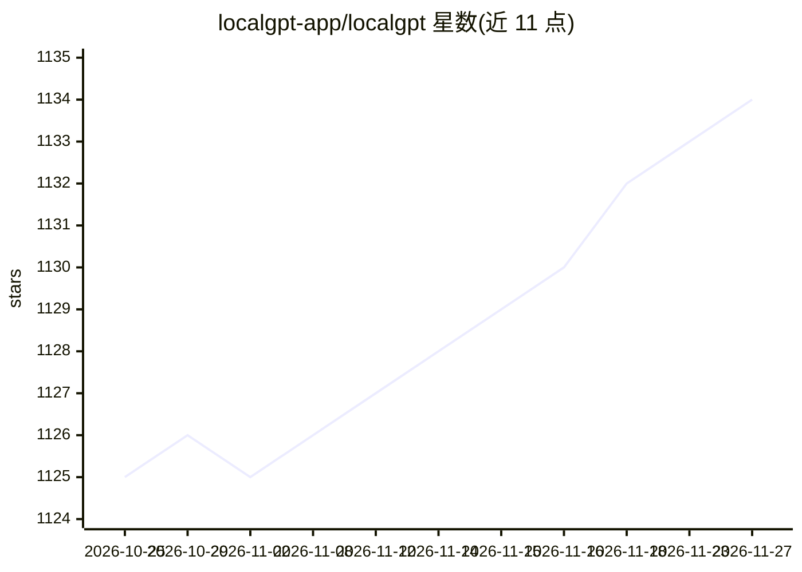

# localgpt-app/localgpt

⭐ 1,134 · Rust · Apache-2.0 · 推送 2026-11-23 · [GitHub](https://github.com/localgpt-app/localgpt) · [官网](https://localgpt.app/) · 组织维护

**把文档/歌曲/剧本变成可漫游 3D 世界并供编码代理编辑的桌面应用**

基于 Rust 与 Bevy 的桌面应用，遵循 Open World Format：一份文档、一首歌、一个剧本或一段提示可生成 `.world` 包，窗口内人工编辑、窗口外编码代理通过 MCP 或 live API 提交操作批次，每次修改记录历史、可撤销、可分支、可回放。应用自身不运行模型、不持有密钥，代理由用户自备。提供桌面 app、`localgpt-gen` 世界构建器二进制、`localgpt` CLI 与 previs 剧本分镜工具；预构建安装支持 npm/brew，源码需 Rust 1.85+。

## 筛选速览

| 维度 | 判定 | 备注 |
|---|---|---|
| AI 角色 | `ai-enhanced` | 去掉 AI 部分产品仍成立 |
| 许可风险 | `permissive` | Apache-2.0 |
| 部署形态 | `library` | 以包/库形式分发 |
| 模型依赖 | — | README 未给出锁定关系 |
| 硬件要求 | — | 无带数字的原话,不猜 |
| 安装摩擦 | `low` | 无编译、无系统依赖或容器化 |
| 成熟度 | — | 结构信号不足 |

## 能力要点

- `.world` 包以 ops.jsonl 日志承载历史：可撤销、可分支、可回放，支持逐作者撤销
- 88 个 gen_* 工具通过 MCP（stdio/HTTP/relay）暴露给外部代理，不调用模型或服务
- Previs 确定性分镜：PDF/Final Draft/Fountain/Markdown 输入，输出 board.html、shotlist.csv 与每场景 .world
- 桌面端支持 macOS/Windows/Linux，局域网或 relay 共享会话观看与漫游

## 适用场景

- 让我的 Claude Code/Codex 等编码代理帮我搭建和修改一个 3D 场景
- 把剧本快速转成分镜板和镜头清单做电影预演
- 和同事在同一窗口里一起走查并回放世界的搭建历史

## 场景标签

 · 领域:开发工具/3D 内容创作

## 证据(README 行号)

> L10: **A desktop app where a document, a song, a screenplay or a prompt becomes a `.world` you can walk through, with yo
> L38: `localgpt-app` is Gen's world rendered by Bevy into native eframe/egui panels (`crates/app/src/shell`), with your o

## 星数曲线

2026-10-25 1,125 → 2026-11-27 1,134（+9）

---
*卡片 v1 · prompt 1.4 · 生成 2026-11-24 · 置信度 low · 依据 README sha `ad15c48f77af` · [字段定义](../../DATASET.md)*
