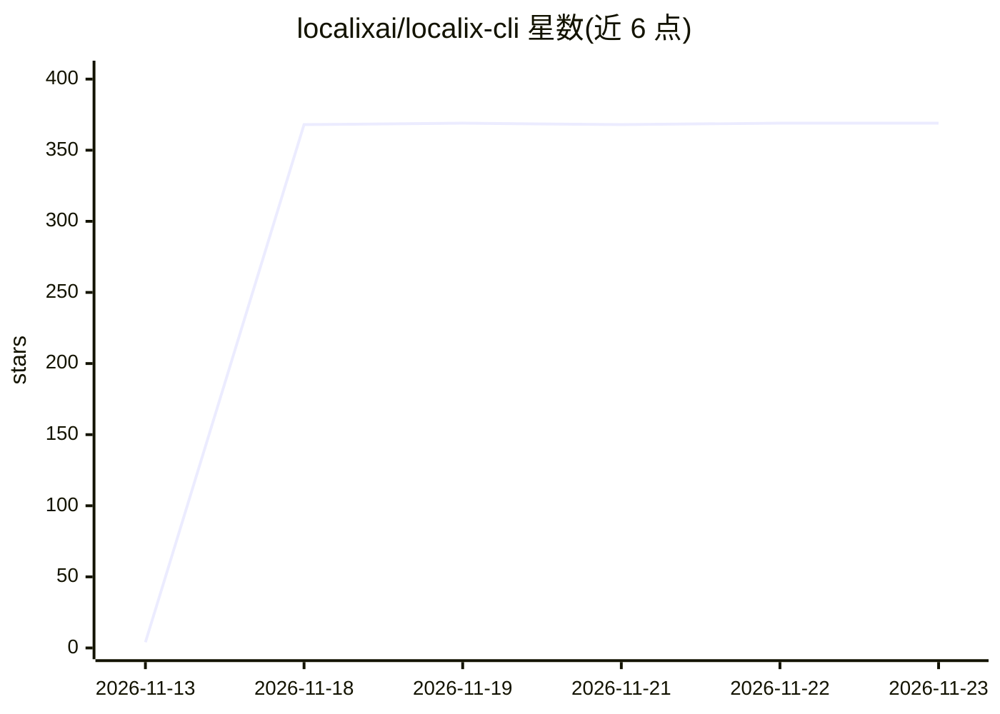

# localixai/localix-cli

⭐ 369 · Rust · MIT · 推送 2026-11-17 · [GitHub](https://github.com/localixai/localix-cli) · [官网](https://cli.localix.ai) · 组织维护

**终端与 CI 用的 Rust 编码 agent 运行时，单二进制，任意模型**

用 Rust 编写的命令行编码 agent（命令 llx），以模型循环调用五个工具（bash/apply_patch/ask/agents/jobs）完成读代码、跑测试、改文件等任务。接入方式包括 ChatGPT 登录、OpenRouter、自有 key（200+ 提供方、1000+ 模型）及本地模型（Ollama、LM Studio、llama.cpp）。命令默认在系统沙箱内运行，仅写入项目目录且不开网络。llx exec 可在 CI（GitHub/GitLab）中以 JSON Schema 输出和退出码交付结果，其他 agent（如 Claude Code）也可将其作为辅助调用。提供 GitHub Action 与预置工作流。

## 筛选速览

| 维度 | 判定 | 备注 |
|---|---|---|
| AI 角色 | `ai-native` | 本体是模型或模型工具 |
| 许可风险 | `permissive` | MIT |
| 部署形态 | `library` | 以包/库形式分发 |
| 模型依赖 | local-ok | 支持本地模型 |
| 硬件要求 | — | 无带数字的原话,不猜 |
| 安装摩擦 | `low` | 无编译、无系统依赖或容器化 |
| 成熟度 | — | 结构信号不足 |

## 能力要点

- 单二进制（<4 MB）安装，支持 200+ 提供方与本地模型
- 五个工具的模型循环，默认沙箱化运行（不写 .git、不开网络）
- llx exec 供 CI 使用，输出 JSON Schema 定义的结构与可分支的退出码
- 会话保存与恢复（llx -c / llx sessions / llx resume）

## 适用场景

- 在终端里让 agent 修测试、改代码
- CI 流水线中跑 PR review、issue 分诊等任务
- 让 Claude Code 等其他 agent 调用 llx 分担子任务

## 场景标签

`编码 Agent` `代码审查` · 领域:编码与开发

## 证据(README 行号)

> L5:  An ultrafast, lightweight agent runtime for coding and CI
> L7:  A coding agent at your terminal, on any model: a ChatGPT sign-in, OpenRouter, your own key or a local model (Ollama
> L57: llx is a model in a loop over five tools: `bash`, `apply_patch`, `ask`, `agents` and `jobs`. It reads, searches and

## 星数曲线

2026-11-13 4 → 2026-11-23 369（+365）

---
*卡片 v1 · prompt 1.4 · 生成 2026-11-18 · 置信度 mid · 依据 README sha `e1d415c16828` · [字段定义](../../DATASET.md)*
