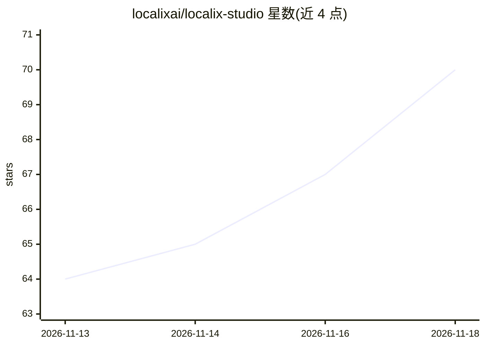

# localixai/localix-studio

⭐ 70 · TypeScript · MIT · 推送 2026-11-17 · [GitHub](https://github.com/localixai/localix-studio) · [官网](https://studio.localix.ai) · 组织维护

**桌面端 agent 开发环境：自带 agent 与子 agent，任意模型**

macOS 桌面应用（Tauri + Bun + Rust），核心是一个 AI agent 及其可并行工作的子 agent，整合编辑器、终端与浏览器，agent 可逐步驱动浏览器页面并检查结果。支持接入各模型或本机运行 GGUF 模型（含 Gemma 4 与 Fastest–Smartest 尺寸选择），可挂接 Claude Code、Codex、Gemini CLI 等外部编码 agent，并兼容 Claude Code 插件格式（/plugin install）。agent 可构建带界面与后端的 mini app，可安装为独立 Mac 应用。macOS Apple silicon 提供签名公证的 dmg，其余平台需从源码运行。

## 筛选速览

| 维度 | 判定 | 备注 |
|---|---|---|
| AI 角色 | `ai-native` | 本体是模型或模型工具 |
| 许可风险 | `permissive` | MIT |
| 部署形态 | `desktop` | 安装包/桌面程序 |
| 模型依赖 | local-ok | 支持本地模型 |
| 硬件要求 | — | 无带数字的原话,不猜 |
| 安装摩擦 | `low` | 无编译、无系统依赖或容器化 |
| 成熟度 | — | 结构信号不足 |

## 能力要点

- 自带 agent 与并行子 agent，整合编辑器、终端与浏览器
- 本机运行 GGUF 模型，数据不出计算机；默认开启基于 embedding 的语义搜索
- 兼容 Claude Code 插件格式（skills、commands、hooks、MCP 等）
- agent 可构建 mini app 并安装为独立 Mac 应用

## 适用场景

- 在桌面端用 agent 与子 agent 并行完成编码与网页操作任务
- 本地运行模型处理敏感代码，数据不外发
- 让 agent 按需生成小型工具应用并安装使用

## 场景标签

`多智能体` `浏览器自动化` `编码 Agent` · 领域:Agent 开发

## 证据(README 行号)

> L7:  An AI agent and its subagents work with you in one desktop app: your editor, terminals and browser. Any model, or r
> L39:  Any model
> L40:  Sign in or bring a key, or run models on this computer.

## 星数曲线

2026-11-13 64 → 2026-11-18 70（+6）

---
*卡片 v1 · prompt 1.4 · 生成 2026-11-18 · 置信度 high · 依据 README sha `90844a086452` · [字段定义](../../DATASET.md)*
