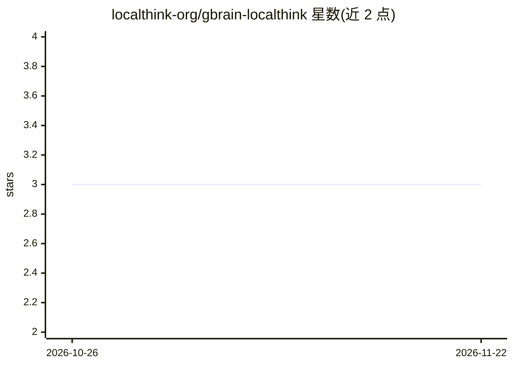

# localthink-org/gbrain-localthink

⭐ 3 · Python · MIT · 推送 2026-10-18 · [GitHub](https://github.com/localthink-org/gbrain-localthink) · [官网](https://localthink.org) · 个人维护

**把 AI agent 会话与个人知识库备份到自有 git 仓库的桥接工具**

一个桥接套件，把两类本地优先 AI 用户的数据统一备份：agent 会话 JSONL 日志（转换为 LTF markdown）和 GBrain 知识库导出（gbrain export）。附带 backup.sh / restore.sh 脚本与 cron 模板，推送前用 --scan 扫描明文密钥并阻断，会话转换时脱敏 IP/MAC/邮箱。要求 Python 3.10+、gbrain CLI 与可推送的 git 仓库；仅支持一种 JSONL 结构，其他格式需自写适配器；不提供静态加密。

## 筛选速览

| 维度 | 判定 | 备注 |
|---|---|---|
| AI 角色 | `ai-knowledge` | 知识聚合/清单类 |
| 许可风险 | `permissive` | MIT |
| 部署形态 | `library` | 以包/库形式分发 |
| 模型依赖 | — | README 未给出锁定关系 |
| 硬件要求 | — | 无带数字的原话,不猜 |
| 安装摩擦 | `low` | 无编译、无系统依赖或容器化 |
| 成熟度 | — | 结构信号不足 |

## 能力要点

- agent 会话 JSONL 转 LTF v1.0 markdown，含密钥脱敏与工具输出摘要
- 推送前明文密钥扫描，命中即阻断提交（退出码 2）
- GBrain 页面导出/导入，restore.sh 支持新机器恢复
- 幂等提交推送，无变化时跳过

## 适用场景

- 定期把本地 agent 会话日志备份到自己拥有的 git 仓库
- 换机或机器故障后恢复个人知识库与会话记录
- 推送前拦截意外混入的 API 密钥与私网信息

## 场景标签

 · 领域:个人知识管理/备份工具

## 证据(README 行号)

> L3: **Bridge agent session logs and a personal knowledge brain into one git-owned memory backup.**
> L8: 2. **A personal knowledge brain** (GBrain — Postgres-native personal knowledge with hybrid RAG search), exported to 
> L26: `gbrain-localthink` is the missing wiring: a converter, a backup script, a restore script, and a cron template. No 

## 星数曲线

2026-10-26 3 → 2026-11-22 3（+0）

---
*卡片 v1 · prompt 1.4 · 生成 2026-11-21 · 置信度 low · 依据 README sha `0b2e07705f98` · [字段定义](../../DATASET.md)*
