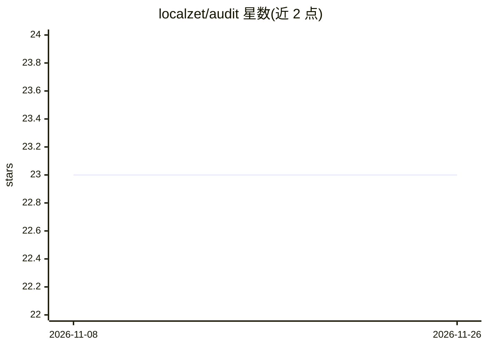

# localzet/audit

⭐ 23 · Python · AGPL-3.0 · 推送 2025-12-19 · [GitHub](https://github.com/localzet/audit) · 个人维护 · 中文 README

**科研用 Linux 系统审计与 ML 异常检测框架骨架**

面向科学研究的 IDS/IPS 机器学习原型项目：模仿 Lynis 的方式在本地运行系统审计、收集系统信息/进程等数据，从中提取特征，再应用 ML 模型（如 IsolationForest、RandomForest baseline）进行异常检测或系统状态分类。支持收集多次审计构建数据集并训练 baseline 模型，配置与流水线固化在代码中以实现可重复实验。项目为骨架/草稿状态，通过 venv + pip 依赖安装，以 Python CLI 方式运行。

## 筛选速览

| 维度 | 判定 | 备注 |
|---|---|---|
| AI 角色 | `ai-native` | 本体是模型或模型工具 |
| 许可风险 | `viral` | AGPL-3.0 |
| 部署形态 | `library` | 以包/库形式分发 |
| 模型依赖 | — | README 未给出锁定关系 |
| 硬件要求 | — | 无带数字的原话,不猜 |
| 安装摩擦 | `low` | 无编译、无系统依赖或容器化 |
| 成熟度 | `idea` | |

## 能力要点

- Lynis 式 CLI 单脚本运行系统审计与检查集
- 从审计数据提取特征并应用 ML 异常检测/分类
- collect_dataset 命令批量采集审计构建训练数据集
- 配置与流水线固化在代码中以支持可重复实验

## 适用场景

- 科研中验证 IDS/IPS 异常检测模型与特征方案
- 本地系统审计采集数据并训练 baseline 模型
- 扩展自定义审计检查项与特征工程实验

## 场景标签

`网络安全` `科研工具` · 领域:学习与行业

## 证据(README 行号)

> L1: ## IDS/IPS ML Audit Framework (Lynis-like)
> L5: вычисление метрик/признаков, после чего — применение ML‑моделей
> L9: - **Исследовательская платформа**: удобно добавлять новые признаки и модели.

## 星数曲线

2026-11-08 23 → 2026-11-26 23（+0）

---
*卡片 v1 · prompt 1.4 · 生成 2026-11-18 · 置信度 mid · 依据 README sha `0a83da8602fa` · [字段定义](../../DATASET.md)*
