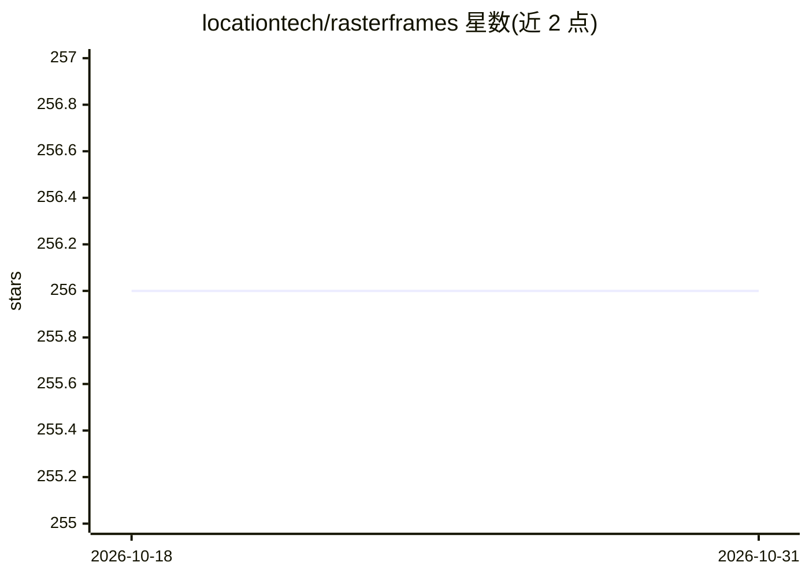

# locationtech/rasterframes

⭐ 256 · Jupyter Notebook · Apache-2.0 · 推送 2025-12-30 · [GitHub](https://github.com/locationtech/rasterframes) · [官网](http://rasterframes.io) · 组织维护

**为 Spark DataFrame 提供地理空间栅格数据支持的库**

面向地球观测（EO）数据分析场景的 Spark 扩展库：在任意栅格数据之上提供以 DataFrame 为核心的视图，支持时空查询与地图代数栅格运算，并兼容 Spark ML 算法生态，使一般分析师可在数据量持续增长的情况下进行可扩展的 EO 数据分析。以 Scala/Spark 库形式提供，入门路径见用户手册的 Getting Started 章节；同时提供 Jupyter Notebook Docker 镜像作为用户资源。采用 Apache 2.0 许可，版权归属 Astraea, Inc.。

## 筛选速览

| 维度 | 判定 | 备注 |
|---|---|---|
| AI 角色 | `ai-ecosystem` | LLM/agent 周边工具 |
| 许可风险 | `permissive` | Apache-2.0 |
| 部署形态 | `None` |  |
| 模型依赖 | — | README 未给出锁定关系 |
| 硬件要求 | — | 无带数字的原话,不猜 |
| 安装摩擦 | `low` | 无编译、无系统依赖或容器化 |
| 成熟度 | — | 结构信号不足 |

## 能力要点

- DataFrame 中心视图覆盖任意栅格数据
- 支持时空查询与地图代数栅格运算
- 与 Spark ML 算法生态兼容
- 提供 Jupyter Notebook Docker 镜像作为用户资源

## 适用场景

- 在 Spark 中对卫星遥感栅格数据做时空查询与分析
- 构建基于 Spark ML 的遥感机器学习流水线
- 以 DataFrame 方式组织大规模地球观测数据

## 场景标签

 · 领域:地球观测/地理空间大数据

## 证据(README 行号)

> L5: RasterFrames® brings together Earth-observation (EO) data access, cloud computing, and DataFrame-based data science.
> L7: RasterFrames provides a DataFrame-centric view over arbitrary raster data, enabling spatiotemporal queries, map alge

## 星数曲线

2026-10-18 256 → 2026-10-31 256（+0）

---
*卡片 v1 · prompt 1.4 · 生成 2026-10-22 · 置信度 mid · 依据 README sha `68ef4367c173` · [字段定义](../../DATASET.md)*
