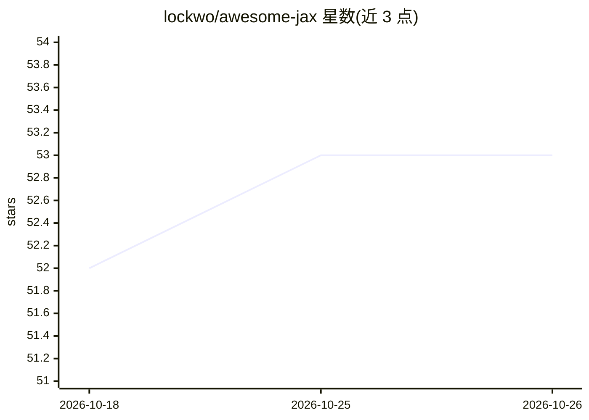

# lockwo/awesome-jax

⭐ 53 · CC0-1.0 · 推送 2026-10-03 · [GitHub](https://github.com/lockwo/awesome-jax) · [官网](https://lockwo.github.io/awesome-jax/) · 个人维护

**JAX 生态资源策展清单：收录库、模型与教程**

基于两个不再维护的 awesome-jax 仓库整理的 JAX 资源清单，收录约 130 个条目，按神经网络、强化学习、NLP、计算机视觉、概率编程与科学计算等类别组织，另设 Up and Coming 与 Inactive 分区，并列出模型实现（如 whisper-jax、esm2quinox）与教程博文。面向使用 JAX 做机器学习研究与科学计算的读者，提供实验性交互式网页版本，接受社区贡献。

## 筛选速览

| 维度 | 判定 | 备注 |
|---|---|---|
| AI 角色 | `ai-knowledge` | 知识聚合/清单类 |
| 许可风险 | `viral` | CC0-1.0 |
| 部署形态 | `None` |  |
| 模型依赖 | — | README 未给出锁定关系 |
| 硬件要求 | — | 无带数字的原话,不猜 |
| 安装摩擦 | `medium` | 含编译或系统依赖之一 |
| 成熟度 | — | 结构信号不足 |

## 能力要点

- 按约 10 个类别组织 130+ 个 JAX 库与项目条目
- 标注 Inactive 库与 Up and Coming 新兴库分区
- 提供实验性交互式网页版本

## 适用场景

- 为 JAX 项目选型时查找特定领域的库（RL/概率编程/PDE 等）
- 了解 JAX 生态中不再活跃的库以避免选用
- 查找 JAX 学习教程与博文

## 场景标签

`精选清单` · 领域:学习与行业

## 证据(README 行号)

> L5: This is a curated list of awesome JAX libraries, projects, and other resources. Contributions are welcome!
> L11: ## Contents

## 星数曲线

2026-10-18 52 → 2026-10-26 53（+1）

---
*卡片 v1 · prompt 1.4 · 生成 2026-10-24 · 置信度 high · 依据 README sha `b61ad1bf7c98` · [字段定义](../../DATASET.md)*
