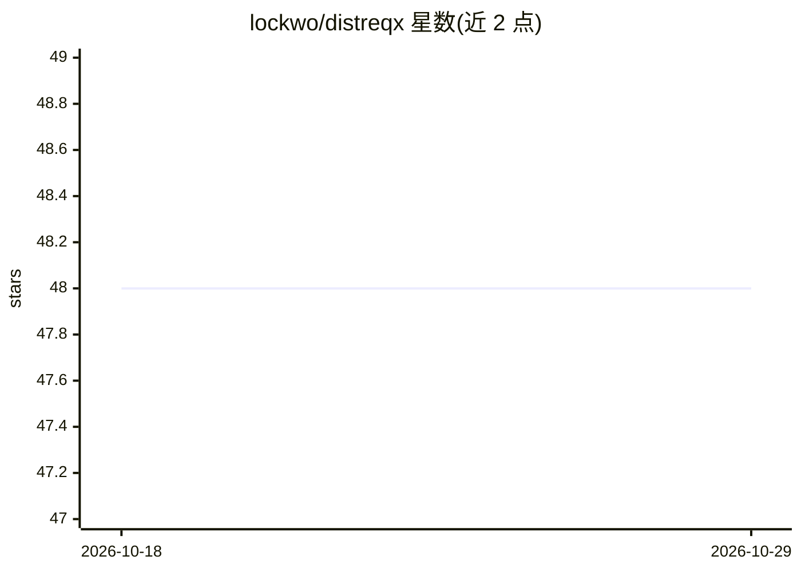

# lockwo/distreqx

⭐ 48 · Python · Apache-2.0 · 推送 2026-09-10 · [GitHub](https://github.com/lockwo/distreqx) · [官网](https://lockwo.github.io/distreqx/) · 个人维护

**基于 JAX/Equinox 的概率分布与双射器库，供开发者构建概率机器学习**

用 Equinox 重新实现 Distrax 而成的 JAX 概率分布与双射器（bijectors）库，代码与测试多取自 Distrax。作为 Pytree 提供，可利用 JAX 的 GPU/TPU 加速、自动微分、向量化与 XLA 编译。与 Distrax 的差异：不官方支持与 TFP 互操作、取消 batch 维度概念（用 vmap 替代）、更广的 Pytree 支持与严格的 abstract/final 设计。需 Python 3.10+、JAX 0.4.11+、Equinox 0.11.0+。

## 筛选速览

| 维度 | 判定 | 备注 |
|---|---|---|
| AI 角色 | `ai-ecosystem` | LLM/agent 周边工具 |
| 许可风险 | `permissive` | Apache-2.0 |
| 部署形态 | `library` | 以包/库形式分发 |
| 模型依赖 | — | README 未给出锁定关系 |
| 硬件要求 | — | 无带数字的原话,不猜 |
| 安装摩擦 | `low` | 无编译、无系统依赖或容器化 |
| 成熟度 | — | 结构信号不足 |

## 能力要点

- 提供概率分布与双jectors 实现及统计/概率机器学习工具
- 基于 Pytree，继承 JAX 的 GPU/TPU 加速、可微分与向量化能力
- 取消 batch 维度，改用 vmap 处理批量
- 提供 Zenodo DOI 可引用

## 适用场景

- 在 JAX 中构建概率模型与分布
- 使用双射器做可逆变换（如归一化流）
- 需要 Pytree 友好分布抽象的研究代码

## 场景标签

 · 领域:机器学习/概率统计库

## 证据(README 行号)

> L4: distreqx (pronounced "dist-rex") is a JAX-based library providing implementations of distributions, bijectors, and t
> L6: The origin of this package is a reimplementation of distrax, (which is a subset of TensorFlow Probability (TFP), wit

## 星数曲线

2026-10-18 48 → 2026-10-29 48（+0）

---
*卡片 v1 · prompt 1.4 · 生成 2026-10-25 · 置信度 high · 依据 README sha `665b5f9f96bb` · [字段定义](../../DATASET.md)*
