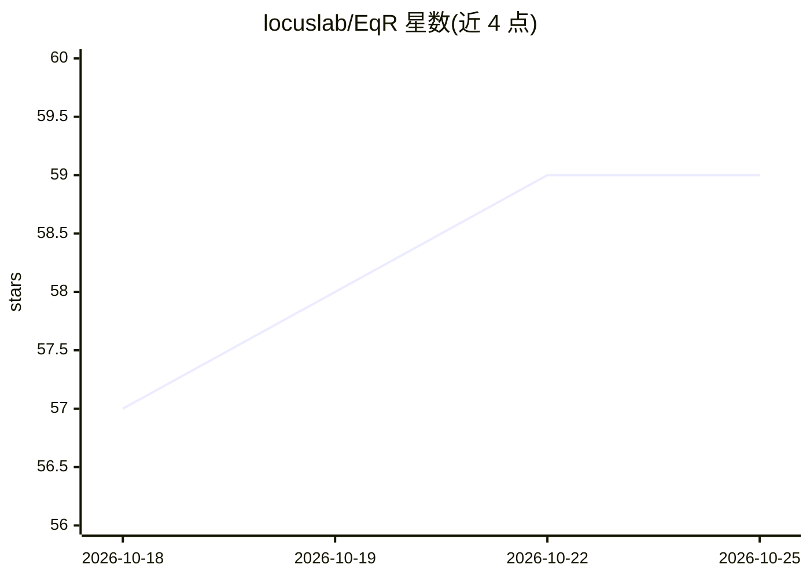

# locuslab/EqR

⭐ 59 · Python · Apache-2.0 · 推送 2026-09-14 · [GitHub](https://github.com/locuslab/EqR) · [官网](https://x.com/huskydogewoof/status/2057641657580064941?s=20) · 组织维护

**ICML 2026 论文代码：用吸引子动力学训练均衡推理模型解 Sudoku 与 Maze**

CMU 研究者发布的 EqR（Equilibrium Reasoners）官方复现代码，配套 arXiv 论文与 Hugging Face 模型/数据。EqR 通过学习吸引子动力学的均衡建模与循环推理完成推理任务，仓库覆盖 Sudoku-Extreme 与 Maze-Unique 两个任务的数据下载/重建、训练（含 TRM/HRM 基线配置）、评估与预训练 checkpoint 下载。训练依赖 CUDA：adam-atan2 需编译 CUDA 后端，Maze 训练需 FlashAttention（优先 FA3，回退 FA2）。评估可在单机或多 GPU（torchrun/Slurm）下复现论文指标，Sudoku 全量评估 8 GPU 约 33.6 小时。面向科研复现者，Apache 2.0 许可。

## 筛选速览

| 维度 | 判定 | 备注 |
|---|---|---|
| AI 角色 | `ai-native` | 本体是模型或模型工具 |
| 许可风险 | `permissive` | Apache-2.0 |
| 部署形态 | `library` | 以包/库形式分发 |
| 模型依赖 | — | README 未给出锁定关系 |
| 硬件要求 | — | 无带数字的原话,不猜 |
| 安装摩擦 | `medium` | 含编译或系统依赖之一 |
| 成熟度 | — | 结构信号不足 |

## 能力要点

- 学习吸引子动力学的均衡推理模型 EqR，含循环推理评估（depth/breadth、多初始化、收敛 top-k 选择）
- 提供 Sudoku-Extreme 与 Maze-Unique 数据集下载/重建脚本及预训练 checkpoint
- 内置 TRM 与 HRM 基线训练配置，附小模型调参结论（d=42 约 39.9K 核心参数达 98.6% 精确率）
- 支持单机及多 GPU/多节点分布式训练与评估

## 适用场景

- 复现 ICML 2026 EqR 论文的 Sudoku 与 Maze 实验
- 基于预训练 checkpoint 直接评估均衡推理效果
- 对比 EqR 与 TRM/HRM 基线在相同训练预算下的表现
- 研究吸引子动力学与均衡建模在推理任务中的应用

## 场景标签

`科研工具` `模型训练` · 领域:学习与行业

## 证据(README 行号)

> L18: Code for reproducing EqR experiments on Sudoku-Extreme and Maze-Unique.
> L22:  EqR recurrent inference

## 星数曲线

2026-10-18 57 → 2026-10-25 59（+2）

---
*卡片 v1 · prompt 1.4 · 生成 2026-10-24 · 置信度 mid · 依据 README sha `607ebc70b5f7` · [字段定义](../../DATASET.md)*
