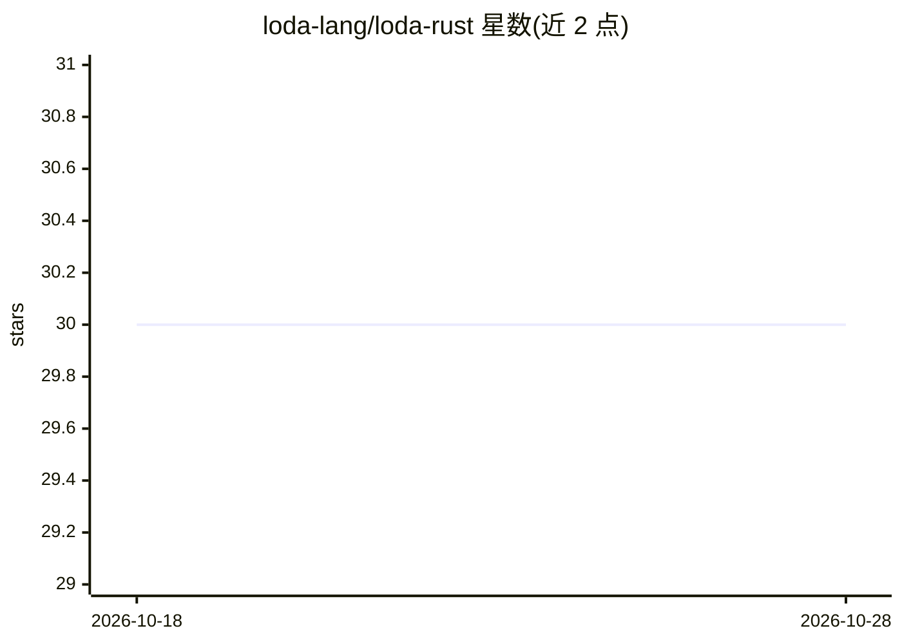

# loda-lang/loda-rust

⭐ 30 · Rust · Apache-2.0 · 推送 2026-08-28 · [GitHub](https://github.com/loda-lang/loda-rust) · [官网](https://loda-lang.org/) · 组织维护

**LODA 语言的 Rust 实现：浏览器运行与 CLI 评估整数序列程序**

LODA-CPP 项目的 Rust 重实现，提供在浏览器中运行 LODA 程序的 Web 编辑器（基于 WASM）以及 Linux/macOS/Windows 命令行界面。CLI 可评估 LODA 程序、识别程序间的循环模式，并包含实验性的 LODA 挖矿器，用于自动发现新的整数序列程序。README 明确说明该挖矿器尚属实验性，挖矿用途建议改用作者的 C++ 版本实现。用户可通过贡献 CPU 算力参与挖掘新程序。

## 筛选速览

| 维度 | 判定 | 备注 |
|---|---|---|
| AI 角色 | `ai-native` | 本体是模型或模型工具 |
| 许可风险 | `permissive` | Apache-2.0 |
| 部署形态 | `None` |  |
| 模型依赖 | — | README 未给出锁定关系 |
| 硬件要求 | — | 无带数字的原话,不猜 |
| 安装摩擦 | `low` | 无编译、无系统依赖或容器化 |
| 成熟度 | `idea` | |

## 能力要点

- 浏览器端 Web 编辑器运行 LODA 程序
- Rust 实现的 LODA-CPP，跨平台 CLI（Linux/macOS/Windows）
- CLI 支持程序评估、跨程序模式识别与实验性挖矿器

## 适用场景

- 在浏览器中编写并运行 LODA 整数序列程序
- 用命令行批量评估与模式分析 LODA 程序
- 贡献 CPU 算力参与挖掘发现新的序列程序

## 场景标签

 · 领域:数学/整数序列计算

## 证据(README 行号)

> L15: LODA-RUST is a Rust implementation of the LODA-CPP project.
> L21: - Identify recurring patterns across LODA programs.
> L22: - Experimental LODA miner.

## 星数曲线

2026-10-18 30 → 2026-10-28 30（+0）

---
*卡片 v1 · prompt 1.4 · 生成 2026-10-26 · 置信度 mid · 依据 README sha `3c496c6bff4b` · [字段定义](../../DATASET.md)*
