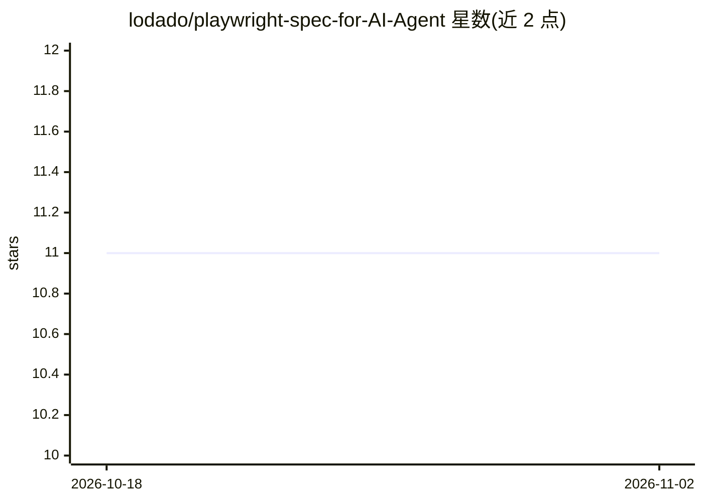

# lodado/playwright-spec-for-AI-Agent

⭐ 11 · TypeScript · 推送 2026-10-08 · [GitHub](https://github.com/lodado/playwright-spec-for-AI-Agent) · 个人维护

**把已有 Playwright spec 转为 AI 判定的线上 staging 验证 CLI**

面向已编写 Playwright spec 的团队的 Node.js CLI：读取 spec 中的 @qa-scenario 等注释，将场景抽象为 Given/When/Then 计划，派 AI agent（Hermes/Aside/Claude Code/Codex/自定义 CLI 等）浏览真实 staging 页面，由 harness 而非 agent 依据证据裁定 pass/fail/manual_review/skip。含 15 个命令、GitHub issue 闭环（nightly --with-issues）、本地与 Browserbase 浏览器提供方。零运行时依赖，@playwright/test 为可选 peer；不执行测试套件，歧义结果归入 manual_review。

## 筛选速览

| 维度 | 判定 | 备注 |
|---|---|---|
| AI 角色 | `ai-ecosystem` | LLM/agent 周边工具 |
| 许可风险 | `permissive` | — |
| 部署形态 | `library` | 以包/库形式分发 |
| 模型依赖 | — | README 未给出锁定关系 |
| 硬件要求 | — | 无带数字的原话,不猜 |
| 安装摩擦 | `low` | 无编译、无系统依赖或容器化 |
| 成熟度 | — | 结构信号不足 |

## 能力要点

- 读取 spec 注释生成 Given/When/Then 计划，由 harness 而非 agent 决定判定结果
- 六类 AI 适配器（Hermes/Aside/exec/Stagehand/fixture/自定义模块）
- 四级判定 pass/fail/manual_review/skip，含 SPEC_GAP 等原因标注
- nightly --with-issues 按 page 建 GitHub issue 形成修复闭环

## 适用场景

- 上线前用已有 Playwright spec 对 staging 页面做活体验证
- 把歧义验证结果整理为 GitHub issue 交给 coding agent 修复
- 离线一条命令体验完整流水线（npx demo）

## 场景标签

`浏览器自动化` · 领域:效率与自动化

## 证据(README 行号)

> L9: Your `*.spec.ts` files already encode what "correct" means. This CLI reads the
> L190: Choose **who judges** with `QA_AI_ADAPTER`. Choose **where the browser runs**
> L194: |AI adapter|What runs|Login/browser model|Browserbase judge|

## 星数曲线

2026-10-18 11 → 2026-11-02 11（+0）

---
*卡片 v1 · prompt 1.4 · 生成 2026-11-02 · 置信度 high · 依据 README sha `be76f32a06c3` · [字段定义](../../DATASET.md)*
