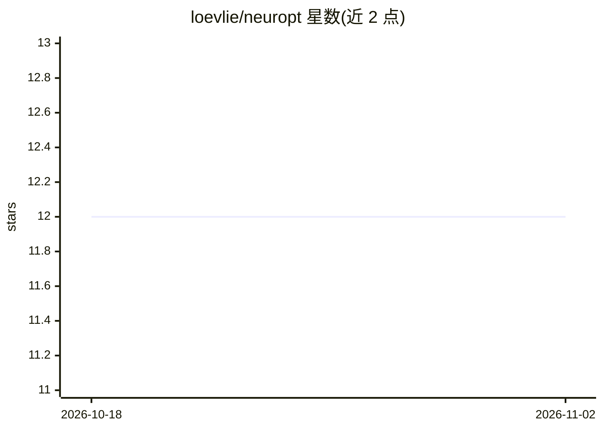

# loevlie/neuropt

⭐ 12 · Python · MIT · 推送 2026-10-31 · [GitHub](https://github.com/loevlie/neuropt) · [官网](https://loevlie.github.io/neuropt/) · 个人维护

**给 ML 研究者：用 LLM 读取训练曲线设计下一轮实验的优化器**

面向 PyTorch 训练流程的 LLM 引导优化工具：指向一个训练脚本，LLM 读取完整 per-epoch train/val 曲线（如发现过拟合），提出下一组架构或超参实验。支持两种定义方式：显式 search space 或通过 from_model() 自动内省模型（检测激活、dropout、pooling 等）。后端支持 Claude（推荐）与 OpenAI API，另有实验性本地 Qwen 后端。提供 CLI（run/inspect/results）、Python API、断点恢复与 notebook 运行，含与 Optuna/随机搜索的基准对比。

## 筛选速览

| 维度 | 判定 | 备注 |
|---|---|---|
| AI 角色 | `ai-ecosystem` | LLM/agent 周边工具 |
| 许可风险 | `permissive` | MIT |
| 部署形态 | `library` | 以包/库形式分发 |
| 模型依赖 | locked-api |  |
| 硬件要求 | — | 无带数字的原话,不猜 |
| 安装摩擦 | `low` | 无编译、无系统依赖或容器化 |
| 成熟度 | `idea` | |

## 能力要点

- LLM 读取完整 per-epoch 训练曲线并提出下一步实验
- from_model() 自动内省模型结构生成搜索空间
- CLI 与 Python API（ArchSearch）双入口，crash-safe 可恢复
- 多后端：Claude、OpenAI 及实验性本地 Qwen

## 适用场景

- 夜间挂机自动做 CNN 架构搜索或超参调优
- 替代/对照 Optuna TPE 做小预算（15 eval）调参
- 对预训练模型做 freeze 策略与 L2-SP 微调搜索

## 场景标签

`科研工具` · 领域:学习与行业

## 证据(README 行号)

> L11:  An LLM reads your training curves and designs your next experiment.
> L63: search = ArchSearch(train_fn=train_fn, search_space=search_space, backend="claude")

## 星数曲线

2026-10-18 12 → 2026-11-02 12（+0）

---
*卡片 v1 · prompt 1.4 · 生成 2026-11-01 · 置信度 high · 依据 README sha `f36dc829f169` · [字段定义](../../DATASET.md)*
