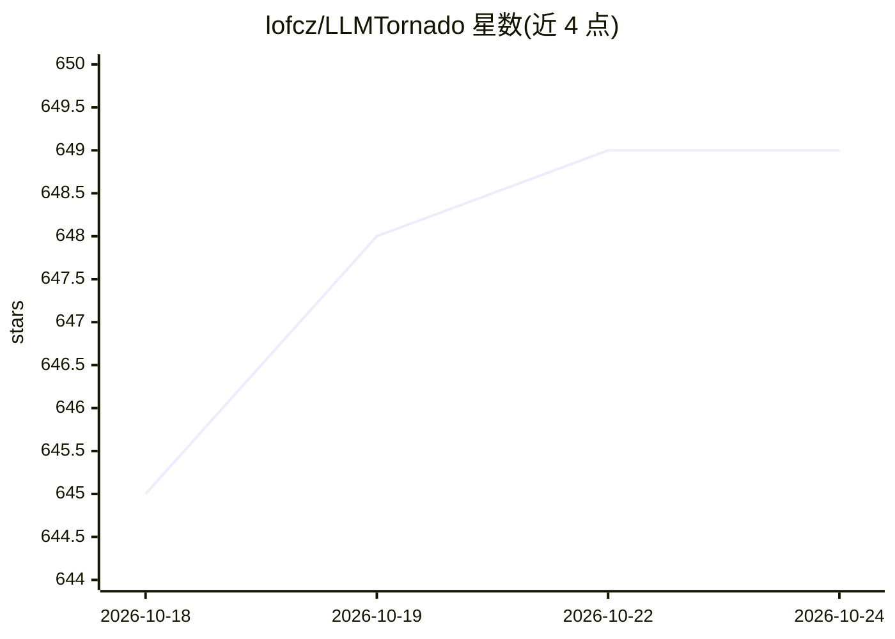

# lofcz/LLMTornado

⭐ 649 · C# · MIT · 推送 2026-10-24 · [GitHub](https://github.com/lofcz/LLMTornado) · [官网](https://llmtornado.ai) · 组织维护

**.NET 的 AI agent/工作流构建 SDK，内置 30+ 提供商连接器**

面向 .NET 开发者的 provider 无关 LLM SDK：以强类型代码暴露各提供商端点，内置对 OpenAI、Anthropic、Google、DeepSeek、Groq、OpenRouter 等 20+ API 提供商及 Chroma、PgVector、Pinecone、Faiss、QDrant 等向量库的连接器，不依赖第一方 SDK。Agent 编排以 Orchestrator（图）/Runner（节点）/Advancer（边）三概念组织，支持 handoff、并行执行与 Mermaid 导出；另提供 MCP、A2A、Skills 协议扩展包及 Microsoft.Extensions.AI 互操作。通过 NuGet 安装，可对接 vLLM/Ollama/LocalAI 自托管部署。

## 筛选速览

| 维度 | 判定 | 备注 |
|---|---|---|
| AI 角色 | `ai-ecosystem` | LLM/agent 周边工具 |
| 许可风险 | `permissive` | MIT |
| 部署形态 | `None` |  |
| 模型依赖 | local-ok | 支持本地模型 |
| 硬件要求 | — | 无带数字的原话,不猜 |
| 安装摩擦 | `medium` | 含编译或系统依赖之一 |
| 成熟度 | — | 结构信号不足 |

## 能力要点

- 20+ API 提供商与 5 种向量数据库的强类型内置连接器
- Orchestrator/Runner/Advancer 三概念的 Agent 编排，支持并行执行与 Mermaid 导出
- MCP、A2A、Skills 协议支持（独立 NuGet 扩展包）
- 与 Microsoft.Extensions.AI 互操作，可插入 Semantic Kernel 应用

## 适用场景

- 在 .NET 应用中统一接入多家 LLM 提供商，改模型名即可切换
- 构建带工具调用、流式输出与多模态输入输出的对话应用
- 编排多专家 Agent 协作完成复杂任务
- 通过 MCP/A2A 协议连接数据源与跨平台 Agent

## 场景标签

`Agent 框架` `多智能体` `模型网关` · 领域:Agent 开发

## 证据(README 行号)

> L15: LLM Tornado is a .NET provider-agnostic SDK that empowers developers to build, orchestrate, and deploy AI agents an
> L22: - **Use Any Provider**: Built-in connectors to: Alibaba, Anthropic, Azure, Blablador, Cohere, DeepInfra, DeepSeek, 

## 星数曲线

2026-10-18 645 → 2026-10-24 649（+4）

---
*卡片 v1 · prompt 1.4 · 生成 2026-10-21 · 置信度 high · 依据 README sha `9ef79ad5d107` · [字段定义](../../DATASET.md)*
