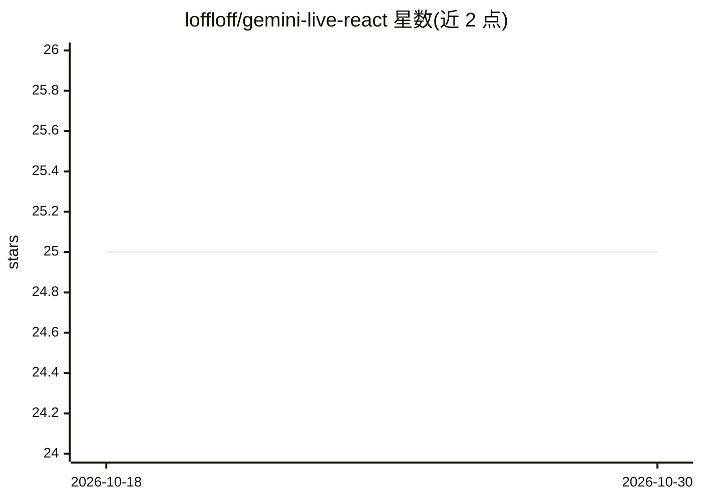

# loffloff/gemini-live-react

⭐ 25 · TypeScript · MIT · 推送 2026-01-20 · [GitHub](https://github.com/loffloff/gemini-live-react) · 个人维护

**React Hook：接入 Gemini Live API 实现实时双向语音**

面向 React 开发者的 npm 库，提供 useGeminiLive Hook 接入 Google Gemini Live API，实现浏览器端实时双向语音流（16kHz PCM 输入/24kHz 输出的格式转换、缓冲与播放链管理）、屏幕共享、工具调用、语音活动检测、实时转录、会话录制回放、多步工作流构建与智能元素检测。架构为浏览器—WebSocket—代理（Deno/Supabase Edge Function）—WebSocket—Gemini Live API，需自部署代理组件。MIT 许可，附示例与移动端兼容指南。

## 筛选速览

| 维度 | 判定 | 备注 |
|---|---|---|
| AI 角色 | `ai-ecosystem` | LLM/agent 周边工具 |
| 许可风险 | `permissive` | MIT |
| 部署形态 | `library` | 以包/库形式分发 |
| 模型依赖 | — | README 未给出锁定关系 |
| 硬件要求 | — | 无带数字的原话,不猜 |
| 安装摩擦 | `low` | 无编译、无系统依赖或容器化 |
| 成熟度 | — | 结构信号不足 |

## 能力要点

- useGeminiLive Hook 提供全双工音频流与音频格式/字节序/缓冲处理
- 会话录制导出 JSON 并可回放调试，事件含 transcript/tool_call 等 11 类
- Workflow Builder 定义 AI 可执行的多步自动化（browser_control/condition/ai_prompt）
- Smart Element Detection 无需 CSS 选择器识别可交互元素

## 适用场景

- 在 React 应用中快速搭建实时语音对话界面
- 构建能看见屏幕并执行浏览器操作的 AI 助手
- 录制和回放语音会话用于调试或训练数据

## 场景标签

`语音 Agent` `浏览器自动化` · 领域:效率与自动化

## 证据(README 行号)

> L3: Real-time bidirectional voice streaming with Google Gemini Live API for React.
> L27: ```bash
> L214: ┌─────────────┐     WebSocket      ┌──────────────┐     WebSocket      ┌─────────────┐

## 星数曲线



2026-10-18 25 → 2026-10-30 25（+0）


---
*卡片 v1 · prompt 1.4 · 生成 2026-10-27 · 置信度 high · 依据 README sha `73c7b1486b27` · [字段定义](../../DATASET.md)*
