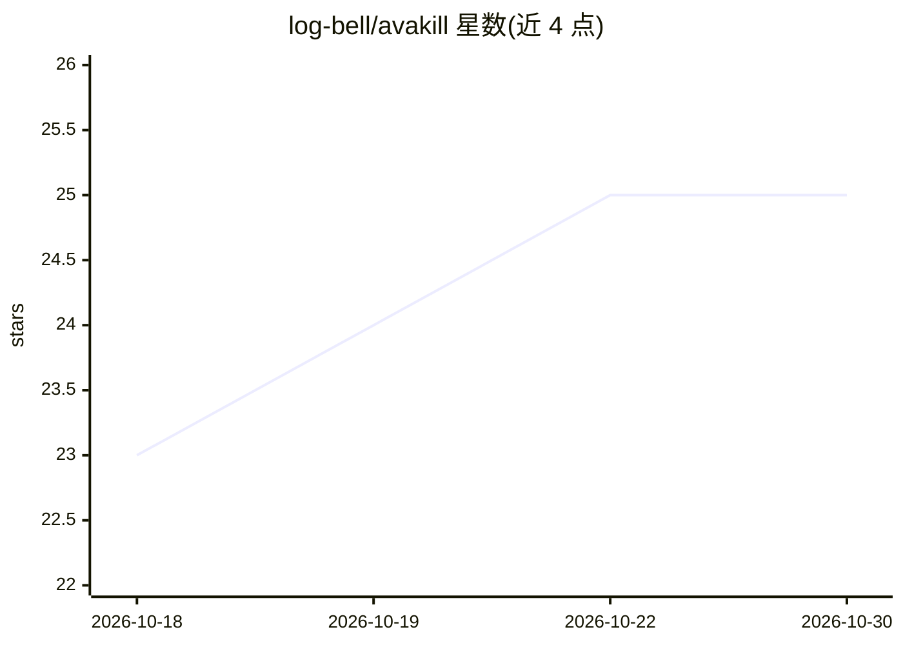

# log-bell/avakill

⭐ 25 · Python · AGPL-3.0 · 推送 2026-03-10 · [GitHub](https://github.com/log-bell/avakill) · [官网](https://avakill.vercel.app) · 个人维护

**AI agent 工具调用防火墙：拦截危险操作并按 YAML 策略拦截**

面向在生产环境运行 AI agent 的开发者与团队的开源安全防护工具。在 agent 与工具之间拦截每次工具调用，按单一 YAML 策略（deny 默认、glob、参数匹配、shell 安全、路径解析、内容扫描、限流、审批门）做确定性规则判定，<1ms 无 ML 模型。提供三条独立执行路径：原生 hooks（Claude Code、Cursor 等 8 种 agent）、MCP proxy 包装、OS 沙箱（Landlock/sandbox-exec/AppContainer）。附带 Python SDK、CLI、审计日志、策略签名与 SOC 2 等合规报告。macOS 14+ 需用 pipx 或虚拟环境安装。AGPL-3.0 许可。

## 筛选速览

| 维度 | 判定 | 备注 |
|---|---|---|
| AI 角色 | `ai-ecosystem` | LLM/agent 周边工具 |
| 许可风险 | `viral` | AGPL-3.0 |
| 部署形态 | `library` | 以包/库形式分发 |
| 模型依赖 | locked-api |  |
| 硬件要求 | — | 无带数字的原话,不猜 |
| 安装摩擦 | `low` | 无编译、无系统依赖或容器化 |
| 成熟度 | — | 结构信号不足 |

## 能力要点

- 三条独立执行路径：agent hooks / MCP proxy / OS 沙箱，无需守护进程
- 81 条规则目录、14 类别，deny 默认的 YAML 策略，纯规则判定 <1ms
- 内容扫描（secrets/PII/prompt injection）与人工审批工作流
- 策略签名（HMAC-SHA256 + Ed25519）与 SOC 2/NIST AI RMF/EU AI Act 合规报告

## 适用场景

- 生产环境 agent 上线前拦截破坏性 shell 或文件操作
- 为 Claude Code / Cursor 等 coding agent 统一安装安全 hook
- MCP 服务器的工具调用与响应内容审计
- 生成并验证合规报告以应对 SOC 2 等框架要求

## 场景标签

`网络安全` · 领域:学习与行业

## 证据(README 行号)

> L31: **AvaKill is that missing layer.** A firewall that intercepts every tool call, evaluates it against your safety pol
> L44: 1. **Detects agents** across three enforcement paths (hooks, MCP proxy, OS sandbox)
> L84: **Native Agent Hooks**

## 星数曲线

2026-10-18 23 → 2026-10-30 25（+2）

---
*卡片 v1 · prompt 1.4 · 生成 2026-10-27 · 置信度 high · 依据 README sha `0c3f957742a9` · [字段定义](../../DATASET.md)*
