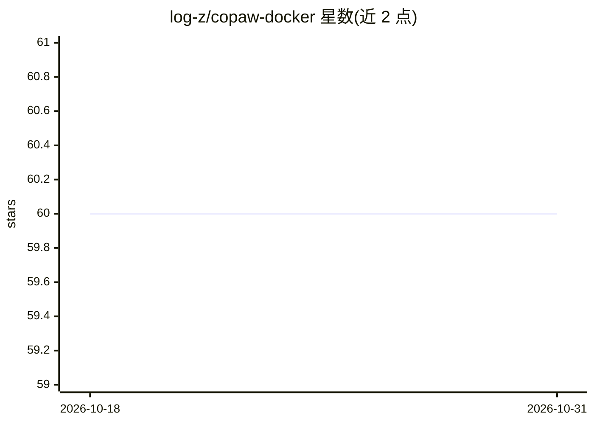

# log-z/copaw-docker

⭐ 60 · Shell · Apache-2.0 · 推送 2026-10-22 · [GitHub](https://github.com/log-z/copaw-docker) · 个人维护 · 中文 README

**QwenPaw 个人 AI 助手的 Docker 部署方案，一键构建运行**

为 QwenPaw（原 CoPaw，基于 AgentScope 框架的个人 AI 助手）提供 Docker 部署方案：发布 ghcr.io/Docker Hub 预构建镜像，支持 docker run、Docker Compose 与自行构建三种方式，基础镜像为 python:3.13-slim，以非 root 用户运行。提供可选安全认证、数据卷持久化（配置、记忆、工作区、会话历史 SQLite）、端口绑定与网络配置说明，并同步上游版本变更与安全修复。面向需在自托管环境中运行 QwenPaw 的用户。

## 筛选速览

| 维度 | 判定 | 备注 |
|---|---|---|
| AI 角色 | `ai-ecosystem` | LLM/agent 周边工具 |
| 许可风险 | `permissive` | Apache-2.0 |
| 部署形态 | `self-host` | docker 或自建部署 |
| 模型依赖 | — | README 未给出锁定关系 |
| 硬件要求 | — | 无带数字的原话,不猜 |
| 安装摩擦 | `low` | 无编译、无系统依赖或容器化 |
| 成熟度 | — | 结构信号不足 |

## 能力要点

- 预构建镜像经 ghcr.io/Docker Hub 分发，支持一键 docker run 与 Compose 部署
- 可选安全认证（注册页、IP 白名单、密码重置）与默认 127.0.0.1 端口绑定
- Docker 数据卷持久化配置、记忆、技能、插件与滚动上下文历史
- 镜像基于 python:3.13-slim、Node 22.x LTS（MCP 功能）、非 root 运行

## 适用场景

- 在自己的服务器上一键部署 QwenPaw AI 助手
- 通过 Docker Compose 管理、更新与备份数据卷
- 自定义构建镜像以适配特定版本或安全修复

## 场景标签

`AI 助手` · 领域:对话与助手

## 证据(README 行号)

> L6: **支持一键构建和运行，相比官方镜像更小**
> L8: QwenPaw（原 CoPaw 项目）是一款个人 AI 助手，部署在你自己的环境中，支持多种聊天平台接入，具备强大的扩展能力。
> L415: 本项目基于 QwenPaw 的官方部署方案构建。QwenPaw 由 AgentScope 团队 开发，采用 Apache License 2.0 开源许可。

## 星数曲线

2026-10-18 60 → 2026-10-31 60（+0）

---
*卡片 v1 · prompt 1.4 · 生成 2026-10-24 · 置信度 mid · 依据 README sha `c53fba06ff50` · [字段定义](../../DATASET.md)*
