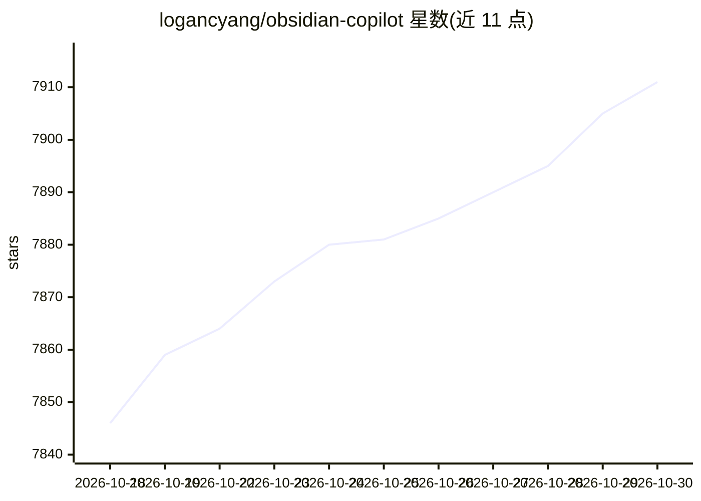

# logancyang/obsidian-copilot

⭐ 7,911 · TypeScript · AGPL-3.0 · 推送 2026-10-29 · [GitHub](https://github.com/logancyang/obsidian-copilot) · [官网](https://www.obsidiancopilot.com) · 组织维护

**Obsidian 笔记库内的 AI Agent 插件：接入 opencode/Claude Code/Codex**

面向 Obsidian 用户的 AI 助手插件：将 opencode、Claude Code、Codex 等 CLI agent 引入笔记库，Agent 可检查笔记、调用工具、创建文件并跨多轮工作；另提供 Quick Chat、Quick Ask、Projects、跨 agent 共享 Skills 与 Commands。模型接入支持 Copilot 托管、自带 key（含本地/OpenAI 兼容端点）或 agent 自有登录。插件前端开源，托管模型等付费功能由闭源后端提供，Agent 仅限桌面端。

## 筛选速览

| 维度 | 判定 | 备注 |
|---|---|---|
| AI 角色 | `ai-native` | 本体是模型或模型工具 |
| 许可风险 | `viral` | AGPL-3.0 |
| 部署形态 | `None` |  |
| 模型依赖 | — | README 未给出锁定关系 |
| 硬件要求 | — | 无带数字的原话,不猜 |
| 安装摩擦 | `low` | 无编译、无系统依赖或容器化 |
| 成熟度 | — | 结构信号不足 |

## 能力要点

- 在 Obsidian 内运行 opencode/Claude Code/Codex 三种 agent
- BYOK 支持云端、本地与 OpenAI 兼容 provider，密钥存于设备 Keychain
- Projects、跨 agent 共享 Skills、斜杠 Commands 与多会话
- 无付费也可用自有 agent 账号、API key 或本地模型

## 适用场景

- 在笔记库内让 agent 整理研究资料并生成关联笔记
- 对选中文字直接提问（Quick Ask）
- 为长期项目配置专属指令与可复用上下文

## 场景标签

`AI 助手` `知识库管理` · 领域:对话与助手

## 证据(README 行号)

> L9:  Copilot V4 brings opencode, Claude Code, and Codex into Obsidian for research, writing, and knowledge work.
> L24: **Agent** is the main Copilot experience for multi-step work. It can inspect notes, use tools, create Obsidian file
> L64: The Copilot plugin is open source and works without a Copilot license when you use your own agent account, provider

## 星数曲线

2026-10-18 7,846 → 2026-10-30 7,911（+65）

---
*卡片 v1 · prompt 1.4 · 生成 2026-10-20 · 置信度 high · 依据 README sha `480c93d11224` · [字段定义](../../DATASET.md)*
