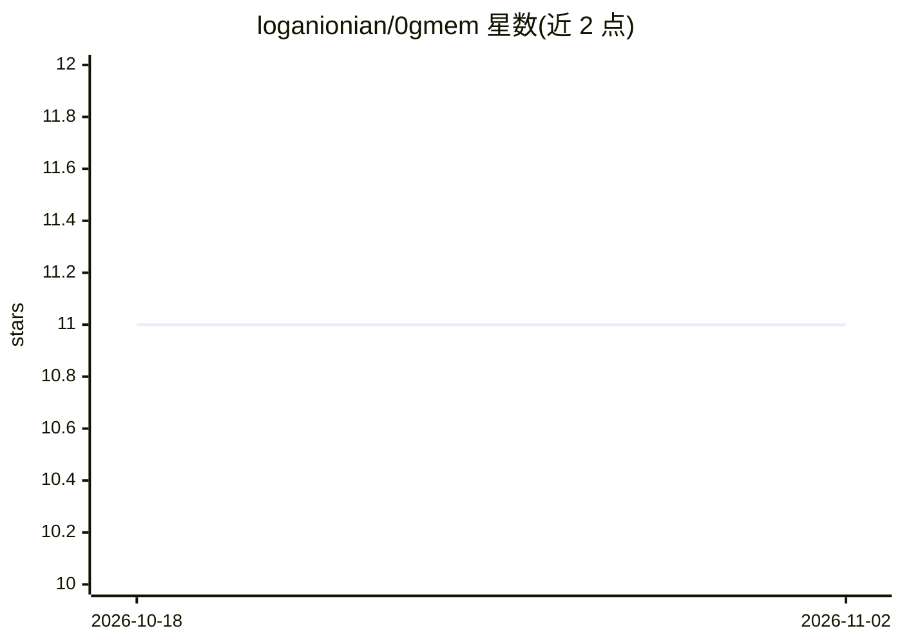

# loganionian/0gmem

⭐ 11 · Python · MIT · 推送 2026-03-24 · [GitHub](https://github.com/loganionian/0gmem) · 个人维护

**面向 AI agent 的长期对话记忆系统：结构化记忆图+混合检索**

为 LLM 提供结构化长期对话记忆的 Python 库，同时以 MCP server 形式供 Claude Code、OpenClaw 等 MCP 客户端作为持久记忆后端。写入时抽取实体、关系、否定与时序（Allen 区间代数），构建含时序/语义/因果/实体四视图的统一记忆图；查询时由 LLM 驱动的 Query Planner 在 8 种检索策略（含 BM25 与语义检索）间生成并执行检索计划，经 RRF 融合与注意力过滤后生成回答。LoCoMo 基准 10 对话子集报告 88.67% 准确率。运行需 OpenAI API key（LLM 与嵌入），默认模型 gpt-5.2，可经环境变量切换。

## 筛选速览

| 维度 | 判定 | 备注 |
|---|---|---|
| AI 角色 | `ai-ecosystem` | LLM/agent 周边工具 |
| 许可风险 | `permissive` | MIT |
| 部署形态 | `library` | 以包/库形式分发 |
| 模型依赖 | — | README 未给出锁定关系 |
| 硬件要求 | — | 无带数字的原话,不猜 |
| 安装摩擦 | `low` | 无编译、无系统依赖或容器化 |
| 成熟度 | — | 结构信号不足 |

## 能力要点

- 写入路径做实体/否定/时序/因果抽取，构建四视图统一记忆图
- LLM 驱动的 Query Planner 在 8 种检索索引上做计划-执行-评估-重规划
- 以 MCP server 形式提供 store/retrieve 等记忆工具，支持任意 stdio MCP 客户端
- LoCoMo 基准 3 对话子集 96.58%、10 对话子集 88.67% 准确率

## 适用场景

- 给 MCP 客户端（如 Claude Code、OpenClaw）接入跨会话持久记忆
- 需要时序推理与否定处理的长期对话记忆检索
- 在 LoCoMo 等长期记忆基准上评估记忆系统效果

## 场景标签

`Agent 记忆` · 领域:Agent 开发

## 证据(README 行号)

> L6: A next-generation AI memory system that gives LLMs structured, long-term conversational memory. Unlike flat vector s
> L214: 0GMem ships as an MCP server, so any MCP-compatible client can use it as a persistent, structured memory backend.
> L216: ### Claude Code

## 星数曲线

2026-10-18 11 → 2026-11-02 11（+0）

---
*卡片 v1 · prompt 1.4 · 生成 2026-11-02 · 置信度 high · 依据 README sha `29db549ab778` · [字段定义](../../DATASET.md)*
