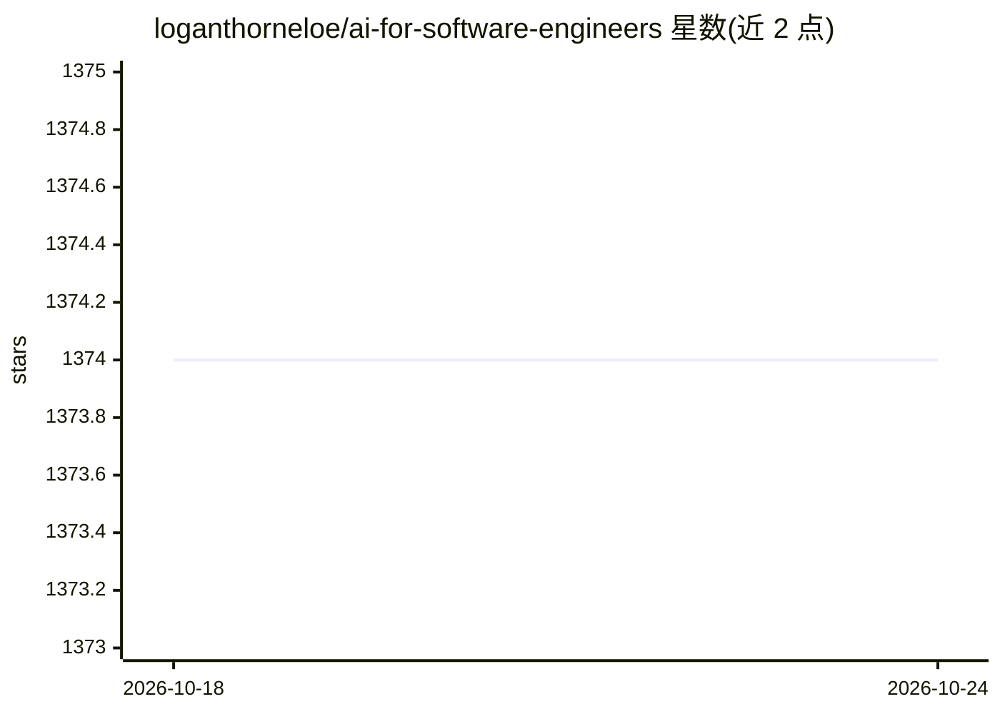

# loganthorneloe/ai-for-software-engineers

⭐ 1,374 · MIT · 推送 2026-08-26 · [GitHub](https://github.com/loganthorneloe/ai-for-software-engineers) · [官网](http://learn.aiforswes.com) · 个人维护

**面向软件工程师的 AI 学习资源清单（书籍/教程）**

由个人维护的 AI 基础学习资源目录，按通用资源、ML 基础、LLM、工程四部分组织，收录书籍、视频系列与在线教程（如 Hands-On ML、3Blue1Brown Transformer 系列、Sebastian Raschka 与 Chip Huyen 的著作等），每条附内容简介，多数资源带配套代码仓库。假定读者已有编程经验，作者另通过 X、Substack 新闻通讯发布补充资源。仓库不含可安装代码，仅文档阅读。

## 筛选速览

| 维度 | 判定 | 备注 |
|---|---|---|
| AI 角色 | `ai-knowledge` | 知识聚合/清单类 |
| 许可风险 | `permissive` | MIT |
| 部署形态 | `None` |  |
| 模型依赖 | — | README 未给出锁定关系 |
| 硬件要求 | — | 无带数字的原话,不猜 |
| 安装摩擦 | `low` | 无编译、无系统依赖或容器化 |
| 成熟度 | — | 结构信号不足 |

## 能力要点

- 四部分结构：通用资源/ML 基础/LLM/工程
- 每条资源附内容简介，多数标注配套代码仓库
- 覆盖从 ML 数学基础到推理服务、大规模训练的工程主题

## 适用场景

- 软件工程师转 AI 方向时规划学习路径
- 查找 LLM 原理与后训练相关的书籍和配套代码
- 了解生产 ML 与推理工程的推荐读物

## 场景标签

`精选清单` `教程课程` · 领域:学习与行业

## 证据(README 行号)

> L5: This repo contains the resources software engineers need to build a foundational understanding of AI. It's split int
> L7: 1. General Resources

## 星数曲线

2026-10-18 1,374 → 2026-10-24 1,374（+0）

---
*卡片 v1 · prompt 1.4 · 生成 2026-10-21 · 置信度 high · 依据 README sha `64f7d421d608` · [字段定义](../../DATASET.md)*
