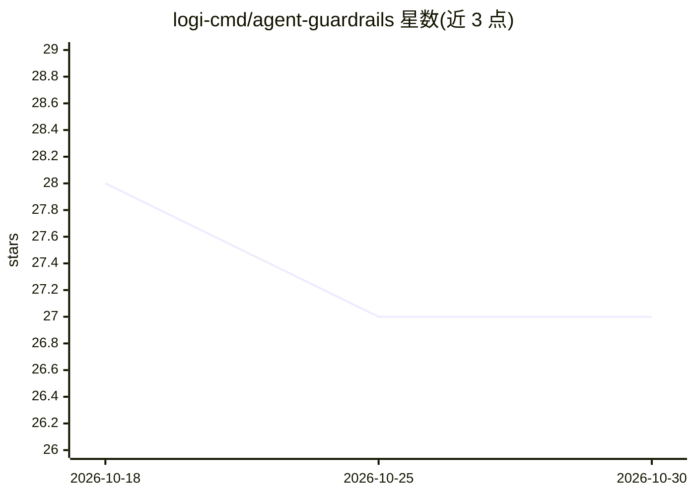

# logi-cmd/agent-guardrails

⭐ 27 · JavaScript · MIT · 推送 2026-08-16 · [GitHub](https://github.com/logi-cmd/agent-guardrails) · [官网](https://www.npmjs.com/package/agent-guardrails) · 组织维护 · 中文 README

**合并前检查 AI 代码改动的仓库级护栏工具**

面向使用 Claude Code、Codex、Cursor、Gemini CLI、OpenCode 等 AI 编码工具的开发者：在合并前检查 AI 生成的代码改动是否越出任务声明范围、是否报告并执行了验证命令、是否存在受保护路径/接口/配置/迁移/疑似密钥等风险，并输出分数、结论与审查摘要。以 npm 全局包提供，内含 Windows/macOS/Linux 原生运行时，通过 setup/plan/check 等命令工作，另支持 stdio MCP 服务器与本地 API 服务，可选用本地 Verity 验证回执。

## 筛选速览

| 维度 | 判定 | 备注 |
|---|---|---|
| AI 角色 | `ai-ecosystem` | LLM/agent 周边工具 |
| 许可风险 | `permissive` | MIT |
| 部署形态 | `library` | 以包/库形式分发 |
| 模型依赖 | — | README 未给出锁定关系 |
| 硬件要求 | — | 无带数字的原话,不猜 |
| 安装摩擦 | `low` | 无编译、无系统依赖或容器化 |
| 成熟度 | — | 结构信号不足 |

## 能力要点

- 范围/验证/一致性/风险四类检查与审查者输出（分数、结论、发现、后续动作）
- 为 5 种 AI 编码工具生成仓库级 helper 文件（CLAUDE.md、.codex/instructions.md 等）
- 内置 stdio MCP 服务器与本地 API 服务，支持受控实现循环
- 可选接入本地 Verity 验证回执作为 verificationEvidence

## 适用场景

- AI 编码助手改完代码后，合并前核验改动是否越出任务范围
- 要求 AI 代理报告并实际运行测试命令，留存可复查的证据
- 通过 MCP 让具备能力的 agent 走受护栏约束的实现-检查循环

## 场景标签

`代码审查` · 领域:编码与开发

## 证据(README 行号)

> L7: `agent-guardrails` checks code changes made by AI coding tools before you merge them. It records what the task is al
> L9: It does not replace Claude Code, Codex, Cursor, Gemini, or OpenCode. It works beside them as a repo-level guardrail.
> L111: |`check --review`|Run a reviewer-facing guardrail check.|

## 星数曲线

2026-10-18 28 → 2026-10-30 27（-1）

---
*卡片 v1 · prompt 1.4 · 生成 2026-10-26 · 置信度 high · 依据 README sha `194d3a97dcbe` · [字段定义](../../DATASET.md)*
