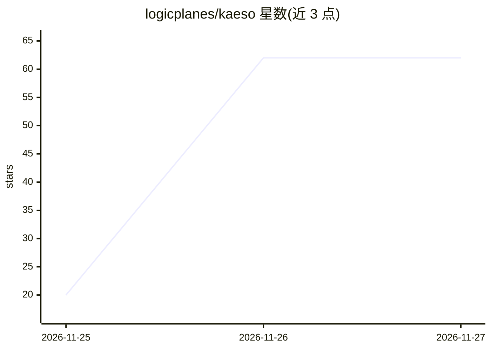

# logicplanes/kaeso

⭐ 62 · Rust · MIT · 推送 2026-11-26 · [GitHub](https://github.com/logicplanes/kaeso) · [官网](https://kaeso.app) · 个人维护 · 中文 README

**自托管 AI 网关：统一 API 接入多家模型供应商**

用 Rust 编写的开源自托管 AI 网关，以 OpenAI、Anthropic、Gemini、ElevenLabs 兼容格式对外提供统一 API，将请求转译并转发给内置的数十家供应商或用户自己的模型服务器，覆盖聊天、嵌入、重排、图像、语音、转录等类型。内置 SSO（OpenID Connect）、SCIM 2.0、角色、硬/软预算、护栏规则、别名路由与回退、请求日志、Playground 和 MCP portal。依赖 PostgreSQL、ClickHouse 和 Valkey，以 Docker Compose 或 Helm Chart 部署，MIT 许可、无付费版本。

## 筛选速览

| 维度 | 判定 | 备注 |
|---|---|---|
| AI 角色 | `ai-ecosystem` | LLM/agent 周边工具 |
| 许可风险 | `permissive` | MIT |
| 部署形态 | `self-host` | docker 或自建部署 |
| 模型依赖 | local-ok | 支持本地模型 |
| 硬件要求 | — | 无带数字的原话,不猜 |
| 安装摩擦 | `low` | 无编译、无系统依赖或容器化 |
| 成熟度 | — | 结构信号不足 |

## 能力要点

- OpenAI/Anthropic/Gemini/ElevenLabs 兼容 API，内置数十家供应商接入
- 别名路由支持条件、加权分流、回退与重试，附带响应缓存
- 按项目/成员/密钥的硬预算与限速，在调用供应商前检查
- 每项目 MCP portal，供 MCP 客户端经统一入口调用 MCP 服务器

## 适用场景

- 为团队搭建自托管的 LLM API 网关并统一记账与日志
- 按项目设置硬性支出预算与速率限制
- 在多个供应商之间配置回退与加权路由
- 统一管理 MCP 服务器并授权多个 MCP 客户端访问

## 场景标签

`模型网关` · 领域:Agent 开发

## 证据(README 行号)

> L7:  The open-source AI gateway you run yourself
> L8:  One OpenAI-, Anthropic-, Gemini- and ElevenLabs-compatible API in front of every provider and your own model server
> L79: Built in are Amazon Bedrock, Anthropic, AssemblyAI, Azure, Baidu Qianfan, Baseten, Cartesia, Cerebras, Cloudflare A

## 星数曲线

2026-11-25 20 → 2026-11-27 62（+42）

---
*卡片 v1 · prompt 1.4 · 生成 2026-11-24 · 置信度 mid · 依据 README sha `3bb0947d9a2e` · [字段定义](../../DATASET.md)*
