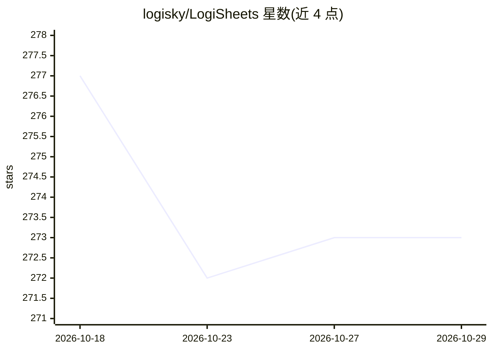

# logisky/LogiSheets

⭐ 273 · Rust · NOASSERTION · 推送 2026-10-25 · [GitHub](https://github.com/logisky/LogiSheets) · [官网](https://www.logisheets.com/) · 个人维护 · 中文 README

**面向人与 AI 协作的 Excel 兼容电子表格引擎与应用**

基于 Rust 引擎编译为 WebAssembly 的电子表格库与应用：读写真实 .xlsx 文件（含公式、样式），同一引擎运行于浏览器、Node.js 与原生 Rust。核心机制是 Blocks——为单元格区域赋予稳定标识与 schema，使 AI agent 以（block, field, key）寻址数据，并支持校验规则、写权限策略与违规报告。附带 logisheets-logician agent 工具包、内置助手 Watson、logisheets-mcp（MCP 协议暴露引擎）及 Crafts 插件系统。MIT 许可，桌面端为实验性 Tauri 壳。

## 筛选速览

| 维度 | 判定 | 备注 |
|---|---|---|
| AI 角色 | `ai-enhanced` | 去掉 AI 部分产品仍成立 |
| 许可风险 | `permissive` | NOASSERTION |
| 部署形态 | `library` | 以包/库形式分发 |
| 模型依赖 | — | README 未给出锁定关系 |
| 硬件要求 | — | 无带数字的原话,不猜 |
| 安装摩擦 | `low` | 无编译、无系统依赖或容器化 |
| 成熟度 | `idea` | |

## 能力要点

- Rust 引擎编译为 WASM，浏览器/Node/Rust 复用同一引擎
- Blocks 提供语义寻址（block, field, key）与 schema、校验、写策略
- logisheets-logician：LLM 工具定义，供 Watson 与 logisheets-mcp 使用
- Crafts 插件系统（craftsmith CLI），发布为 .craft 包运行时安装

## 适用场景

- 在浏览器或 Node 中读写并计算 .xlsx 文件
- 让 AI agent 通过语义地址安全地操作电子表格数据
- 通过 MCP 主机接入电子表格引擎
- 用插件（Crafts）扩展电子表格功能

## 场景标签

 · 领域:办公软件/电子表格引擎

## 证据(README 行号)

> L11: **The spreadsheet as common ground for people and AI.** LogiSheets is a web-based spreadsheet built on a Rust engin
> L19: > An **open-source spreadsheet library** and **Excel (`.xlsx`) engine** for **JavaScript / TypeScript** and **Rust*
> L40: `logisheets-logician` is the agent toolkit: LLM tool definitions that operate a real workbook, plus the prompts and

## 星数曲线

2026-10-18 277 → 2026-10-29 273（-4）

---
*卡片 v1 · prompt 1.4 · 生成 2026-10-22 · 置信度 high · 依据 README sha `a5b458ddc75e` · [字段定义](../../DATASET.md)*
