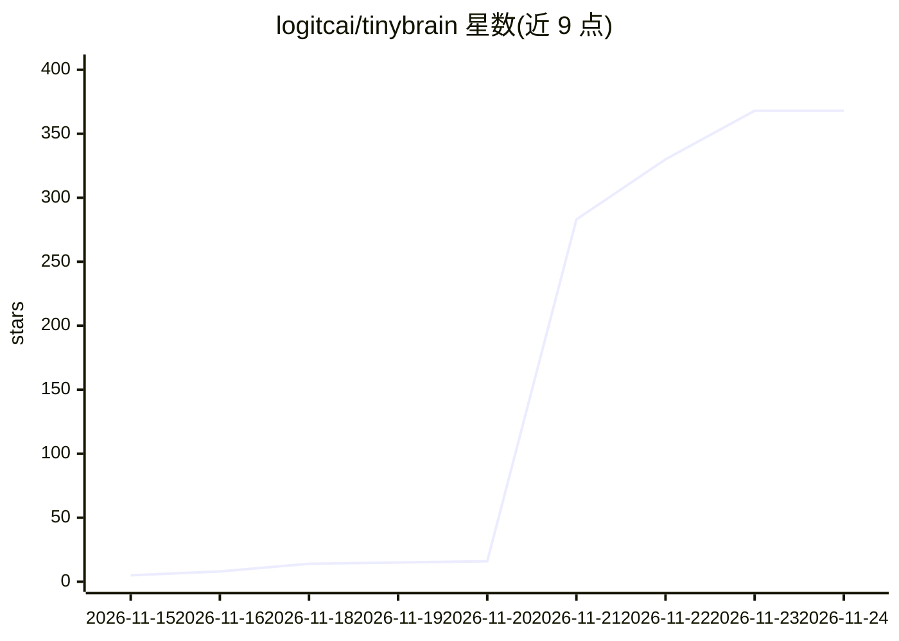

# logitcai/tinybrain

⭐ 368 · Python · MIT · 推送 2026-11-19 · [GitHub](https://github.com/logitcai/tinybrain) · 个人维护 · 中文 README

**从零实现的中文小语言模型全流程项目：数据、分词器、训练到强化学习**

从零构建中文小语言模型的开源项目，代码与数据全部开放。提供 60B token 四档中文混合数据集（含清洗、跨来源去重、质量分档的全套代码）、自训 SentencePiece BPE 分词器（32768 词），模型采用多流残差 mHC、Engram 查表记忆、滑动窗口注意力、可选 MoE 与 Muon 优化器。后训练链覆盖 SFT、领域专家、多老师蒸馏、RLVR/agent RL/RLAIF。通过 pip 安装与 tinybrain CLI 运行，单张 RTX 5070 Ti 16GB 可完整训完 small 档；训练好的权重尚未发布。

## 筛选速览

| 维度 | 判定 | 备注 |
|---|---|---|
| AI 角色 | `ai-native` | 本体是模型或模型工具 |
| 许可风险 | `permissive` | MIT |
| 部署形态 | `library` | 以包/库形式分发 |
| 模型依赖 | — | README 未给出锁定关系 |
| 硬件要求 | `gpu-8g` | |
| 安装摩擦 | `medium` | 含编译或系统依赖之一 |
| 成熟度 | — | 结构信号不足 |

## 能力要点

- 60B token 开源中文数据集，四档分层且去重分档代码全部开放
- mHC 多流残差（双随机矩阵约束）与 Engram 查表记忆结构
- 预训练到 RLVR/agent RL/RLAIF 的全流程后训练链与 10 种题型判分器
- 2300 万参数演示模型可在 M4 Max 上约 3.3 小时跑通整条链

## 适用场景

- 逐行读懂一个中文大模型从数据到 RL 的完整实现
- 在单张 16GB 显卡上完整预训练并后训练小模型
- 获取带来源与许可证标注的中文预训练数据集

## 场景标签

`模型训练` `强化学习` · 领域:训练与推理

## 证据(README 行号)

> L17: tinybrain 是一个从零写起的中文小模型项目。和 MiniMind、nanochat 一样，所有代码都是自己写的、能一行行读懂；不一样的是：
> L21: - **后训练做全套**：SFT → 领域专家 → 多老师在线蒸馏（MOPD）→ 强化学习（RLVR、agent RL、RLAIF），10 种题型、各自的判分器。
> L38: |RTX 5070 Ti 16GB|small（主干 6400 万参数，连词向量和记忆表共 1.67 亿）|nano（10 亿 token）|约 4 小时|

## 星数曲线

2026-11-15 5 → 2026-11-24 368（+363）

---
*卡片 v1 · prompt 1.4 · 生成 2026-11-18 · 置信度 high · 依据 README sha `6ede79583396` · [字段定义](../../DATASET.md)*
