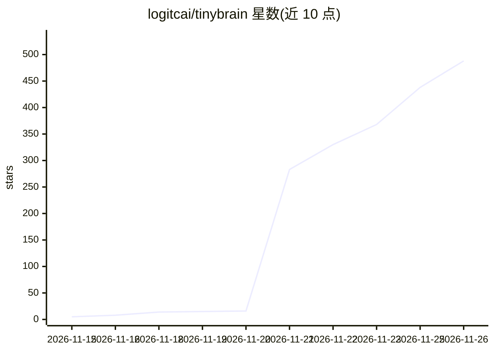

# logitcai/tinybrain

⭐ 488 · Python · MIT · 推送 2026-11-23 · [GitHub](https://github.com/logitcai/tinybrain) · 组织维护 · 中文 README

**从零做中文小模型：数据、分词器、训练全流程开源**

tinybrain 是一个从零实现的中文小语言模型项目，涵盖 60B token 开源中文数据集、SentencePiece 分词器、含 mHC/Engram/MoE 结构的模型定义，以及预训练到 SFT、蒸馏、强化学习的后训练链路，全部基于 PyTorch。发布 small/medium 两档对话权重，提供 chat/serve/generate 等 CLI 命令和 OpenAI 兼容接口。README 明确指出当前权重在事实和算术上不可靠，评测尚未完成，属于研究预览性质。

## 筛选速览

| 维度 | 判定 | 备注 |
|---|---|---|
| AI 角色 | `ai-native` | 本体是模型或模型工具 |
| 许可风险 | `permissive` | MIT |
| 部署形态 | `library` | 以包/库形式分发 |
| 模型依赖 | — | README 未给出锁定关系 |
| 硬件要求 | `gpu-8g` | |
| 安装摩擦 | `medium` | 含编译或系统依赖之一 |
| 成熟度 | `idea` | |

## 能力要点

- 从 26 个公开来源构建的四档中文数据集（nano/mini/base/full）
- 模型结构包含多流残差（mHC）、Engram 查表记忆、3:1 滑动窗口注意力、可选 MoE
- SFT → 领域专家 → 多老师在线蒸馏 → 强化学习（RLVR/agent RL/RLAIF）的完整后训练链
- 提供聊天网页与 OpenAI 兼容接口，网页离线可用

## 适用场景

- 在单张 16GB 消费级显卡上完整走一遍预训练到强化学习的训练流程
- 基于开源中文语料自行训练和调整小语言模型
- 用命令行或网页本地运行已发布的中文对话权重

## 场景标签

`模型训练` `强化学习` · 领域:训练与推理

## 证据(README 行号)

> L11: **从一个字开始，自己做一个中文大模型。**
> L17: tinybrain 是一个从零写起的中文小模型项目。和 MiniMind、nanochat 一样，所有代码都是自己写的、能一行行读懂；不一样的是：
> L21: - **后训练做全套**：SFT → 领域专家 → 多老师在线蒸馏（MOPD）→ 强化学习（RLVR、agent RL、RLAIF），10 种题型、各自的判分器。

## 星数曲线

2026-11-15 5 → 2026-11-26 488（+483）

---
*卡片 v1 · prompt 1.4 · 生成 2026-11-25 · 置信度 high · 依据 README sha `8f1a192b4773` · [字段定义](../../DATASET.md)*
