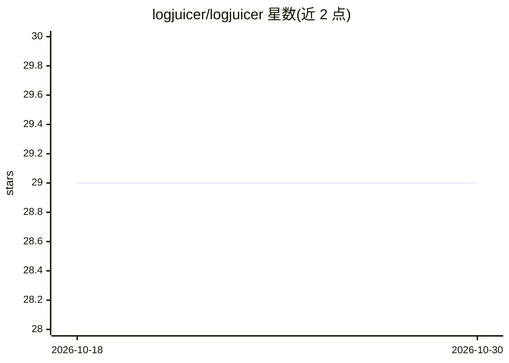

# logjuicer/logjuicer

⭐ 29 · Rust · Apache-2.0 · 推送 2026-10-05 · [GitHub](https://github.com/logjuicer/logjuicer) · [官网](https://logjuicer.github.io) · 组织维护

**基于基线对比从日志中提取异常的命令行工具**

Rust 编写的日志异常提取工具：基于基线日志与目标日志对比，通过分词器去除随机词、hashing trick 转换特征向量、余弦相似度比较，高亮目标日志中的有用文本以辅助定位故障根因。支持自动发现基线（如 service.log 对比历史文件、CI 构建基线）、--model 保存复用训练模型、生成 .html/.json 报告，以及 ant fileset 风格的文件过滤与 ignore_patterns 噪声行配置。提供 CLI 与 WASM 网页界面，面向 CI 日志分析场景。

## 筛选速览

| 维度 | 判定 | 备注 |
|---|---|---|
| AI 角色 | `ai-native` | 本体是模型或模型工具 |
| 许可风险 | `permissive` | Apache-2.0 |
| 部署形态 | `library` | 以包/库形式分发 |
| 模型依赖 | — | README 未给出锁定关系 |
| 硬件要求 | — | 无带数字的原话,不猜 |
| 安装摩擦 | `low` | 无编译、无系统依赖或容器化 |
| 成熟度 | — | 结构信号不足 |

## 能力要点

- tokenizer + hashing trick + 余弦相似度的自定义日志对比流程
- 基线自动发现机制（历史日志文件 / CI 外部服务 API）
- 生成静态报告（.html 查看器 / .json 导出）供归档
- ant fileset 文件过滤与 ignore_patterns 噪声行静默配置

## 适用场景

- CI 构建失败时对比成功构建日志定位异常
- 对比 sosreport 等目录排查故障差异
- 定期日志巡检中高亮与基线不符的异常文本

## 场景标签

 · 领域:运维/日志分析

## 证据(README 行号)

> L3: Based on baseline logs, LogJuicer highlights useful texts in target logs.
> L11: * Lines are converted into feature vectors using the hashing trick.

## 星数曲线

2026-10-18 29 → 2026-10-30 29（+0）

---
*卡片 v1 · prompt 1.4 · 生成 2026-10-26 · 置信度 high · 依据 README sha `db9df1366e86` · [字段定义](../../DATASET.md)*
