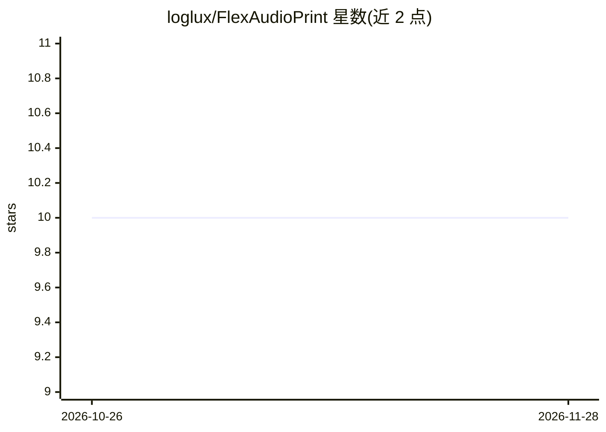

# loglux/FlexAudioPrint

⭐ 10 · Python · MIT · 推送 2026-04-22 · [GitHub](https://github.com/loglux/FlexAudioPrint) · 个人维护

**本地 Whisper 音频转文字应用：网页界面+脚本转录与字幕生成**

基于 Gradio 与 OpenAI Whisper 的音频转文字应用：上传音频后经 FFmpeg 转为 16kHz 单声道 WAV，调用 Whisper 模型生成文本与 SRT 字幕，支持模型选择（tiny 到 large）、上下文提示、翻译按钮与结果下载。另提供 audio_print.py 脚本供命令行/程序化调用。通过 Ollama 运行本地 LLM（gemma3:12b）将原始转写整理为带说话人标注的对话稿。支持本地/远程 API 双模式部署（.env 切换），需 Python 3.10+ 与 ffmpeg。

## 筛选速览

| 维度 | 判定 | 备注 |
|---|---|---|
| AI 角色 | `ai-native` | 本体是模型或模型工具 |
| 许可风险 | `permissive` | MIT |
| 部署形态 | `library` | 以包/库形式分发 |
| 模型依赖 | local-ok | 支持本地模型 |
| 硬件要求 | — | 无带数字的原话,不猜 |
| 安装摩擦 | `medium` | 含编译或系统依赖之一 |
| 成熟度 | `idea` | |

## 能力要点

- Gradio 网页界面 + audio_print.py 命令行两种使用方式
- Whisper 多模型选择，可生成 SRT 字幕与翻译
- Ollama 本地 LLM（gemma3:12b）整理对话稿，无需外部 API
- 本地/远程 Whisper API 双模式，可在多机间分布式部署

## 适用场景

- 转录会议、讲座和播客音频为文字
- 为音视频生成 SRT 字幕文件
- 将转录稿整理成带说话人标注的可读对话稿
- 在低配设备上连接局域网内 GPU 机器做远程转录

## 场景标签

`语音识别` · 领域:感知与多模态

## 证据(README 行号)

> L3: A user-friendly audio transcription web application built using **Gradio** and **OpenAI's Whisper** model. This app 
> L14: - **Accurate Transcription**: Uses OpenAI's **Whisper** model for speech-to-text transcription.
> L20: - **Formatted Dialogue Output**: Automatically formats raw transcripts into clean, readable dialogue scripts using 

## 星数曲线

2026-10-26 10 → 2026-11-28 10（+0）

---
*卡片 v1 · prompt 1.4 · 生成 2026-11-19 · 置信度 high · 依据 README sha `8c0fcd7b5ca9` · [字段定义](../../DATASET.md)*
