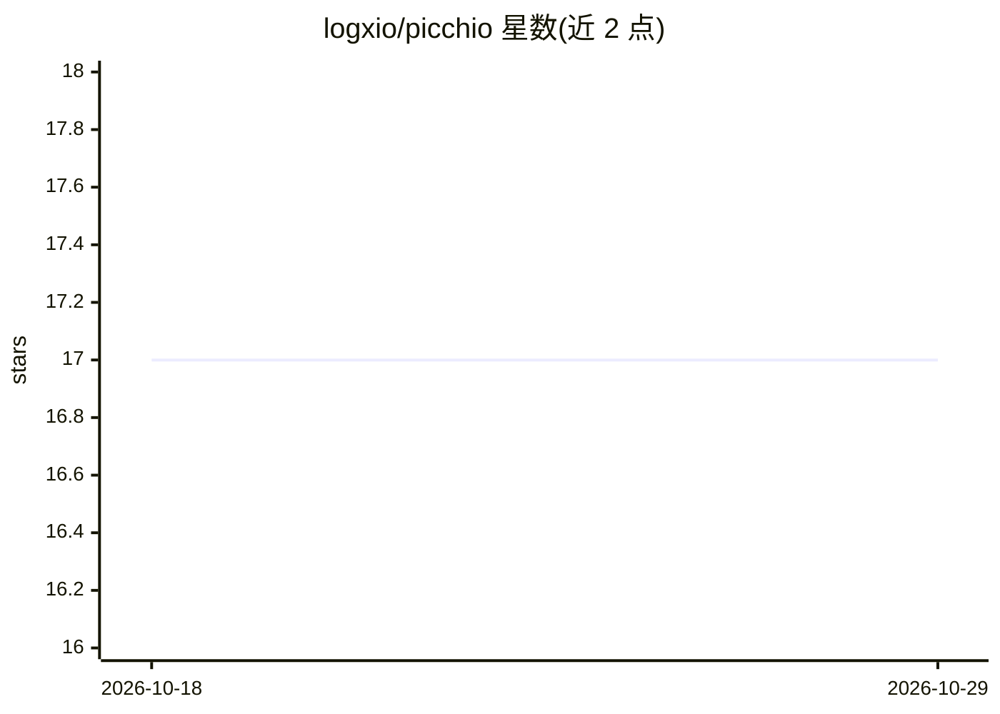

# logxio/picchio

⭐ 17 · Python · MIT · 推送 2026-09-28 · [GitHub](https://github.com/logxio/picchio) · [官网](https://logxio.github.io/picchio/) · 个人维护

**本地 LLM 推理层放置诊断工具：一次运行给出 GPU/CPU 分层与速度证据**

面向本地 LLM 用户的诊断工具：对 llama.cpp、Ollama 或运行中的 llama-server 发起运行，读取引擎的每层放置信息，同时采样 macOS/NVML/amdgpu 的 GPU 活动、显存、功耗，输出分离的 prefill/decode 速度、每 token 能耗，并给出 HEALTHY/CPU FALLBACK/PARTIAL OFFLOAD 判定。提供 plan 模式在下载前从文件头判断模型是否放得下，guard 模式监控运行中进程是否离开 GPU。单文件下载、仅用 Python 3.9+ 标准库；GPU 采样为整卡读数而非按进程归因，原始文件不含独立机器指纹。

## 筛选速览

| 维度 | 判定 | 备注 |
|---|---|---|
| AI 角色 | `ai-ecosystem` | LLM/agent 周边工具 |
| 许可风险 | `permissive` | MIT |
| 部署形态 | `desktop` | 安装包/桌面程序 |
| 模型依赖 | local-ok | 支持本地模型 |
| 硬件要求 | — | 无带数字的原话,不猜 |
| 安装摩擦 | `medium` | 含编译或系统依赖之一 |
| 成熟度 | — | 结构信号不足 |

## 能力要点

- 引擎层放置 + OS 侧 GPU 采样双证据，输出 HEALTHY/CPU FALLBACK/PARTIAL OFFLOAD 判定
- plan 模式在下载前从 GGUF 文件头与 registry manifest 判断模型是否装得下
- guard 模式监控自有命令、已加载模型或服务器，偏离 GPU 时报告
- 生成可直接粘贴到 Ollama/llama.cpp Issue 的完整报告；--json 机器可读输出

## 适用场景

- 我发现本地模型速度不对，想知道它实际跑在 GPU 还是 CPU
- 下载大模型前先确认这台机器的显存/内存装不装得下
- 复现两次运行差异时定位第一个变化的设置并生成 Issue 报告

## 场景标签

`LLM 可观测性` · 领域:评测与运维

## 证据(README 行号)

> L11:  An inference placement receipt joins the engine's layer placement, the system's GPU readings and the run's separat
> L123: - llama.cpp: per-layer placement, applied sampling settings and timing
> L124: - Ollama: CPU/GPU weight split and timing

## 星数曲线

2026-10-18 17 → 2026-10-29 17（+0）

---
*卡片 v1 · prompt 1.4 · 生成 2026-10-29 · 置信度 high · 依据 README sha `2035bfac96a8` · [字段定义](../../DATASET.md)*
