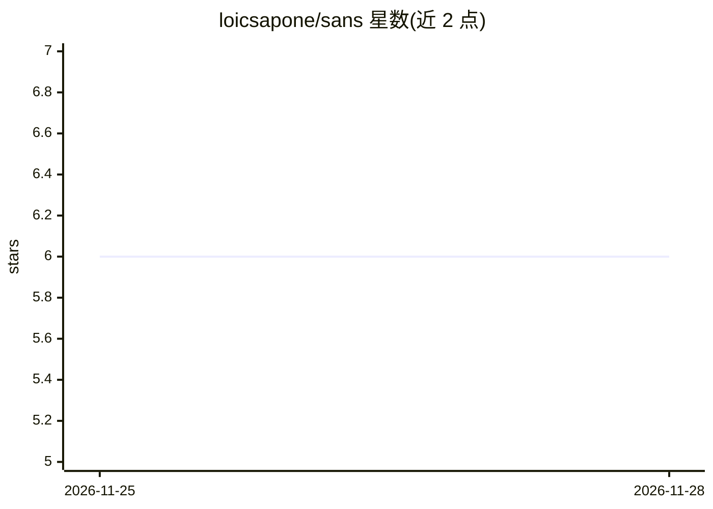

# loicsapone/sans

⭐ 6 · PHP · MIT · 推送 2026-11-20 · [GitHub](https://github.com/loicsapone/sans) · 个人维护

**粘贴食谱链接，检测 14 种欧盟过敏原并给出替换版本**

面向过敏体质用户的食谱分析 Web 应用：粘贴食谱 URL 后提取配料并判定是否含 14 种欧盟法规过敏原，可按用户关闭的过敏原生成替换版本（换食材并改写步骤）。判定逻辑为 PHP 中的确定性查找，语言模型仅负责配料提取、归一化与替换建议。基于 Symfony AI 构建（5 个 agent、向量存储、双向 MCP 服务器），配料比对用 Meilisearch 混合检索，需 Mistral API key，提供 Symfony CLI 与纯 Docker 两种运行方式。

## 筛选速览

| 维度 | 判定 | 备注 |
|---|---|---|
| AI 角色 | `ai-native` | 本体是模型或模型工具 |
| 许可风险 | `permissive` | MIT |
| 部署形态 | `self-host` | docker 或自建部署 |
| 模型依赖 | — | README 未给出锁定关系 |
| 硬件要求 | — | 无带数字的原话,不猜 |
| 安装摩擦 | `low` | 无编译、无系统依赖或容器化 |
| 成熟度 | — | 结构信号不足 |

## 能力要点

- 过敏原判定来自确定性 PHP 查找而非模型输出
- 5 个 agent + 向量存储 + MCP 服务器/客户端，几乎全部通过 YAML 配置声明
- matcher agent 通过 HasSourcesInterface 只能选取检索返回的文档
- 同时作为 MCP 服务器提供 analyze_recipe/adapt_recipe/check_ingredients 三个工具

## 适用场景

- 粘贴食谱链接查看是否含牛奶、鸡蛋、芹菜等过敏原
- 按需排除过敏原后获得替换食材与改写步骤的食谱版本
- 通过 Claude Code 等 MCP 客户端以对话方式查询食谱安全性

## 场景标签

`RAG` · 领域:知识与检索

## 证据(README 行号)

> L5: Paste the URL of a recipe: Sans extracts it, shows which of the 14 EU regulatory allergens it contains, and can prop
> L7: Built for the Symfony AI & MCP Hackathon (RAG, MCP, agents). Every allergen verdict comes from a deterministic looku

## 星数曲线

2026-11-25 6 → 2026-11-28 6（+0）

---
*卡片 v1 · prompt 1.4 · 生成 2026-11-24 · 置信度 high · 依据 README sha `8e8245483393` · [字段定义](../../DATASET.md)*
