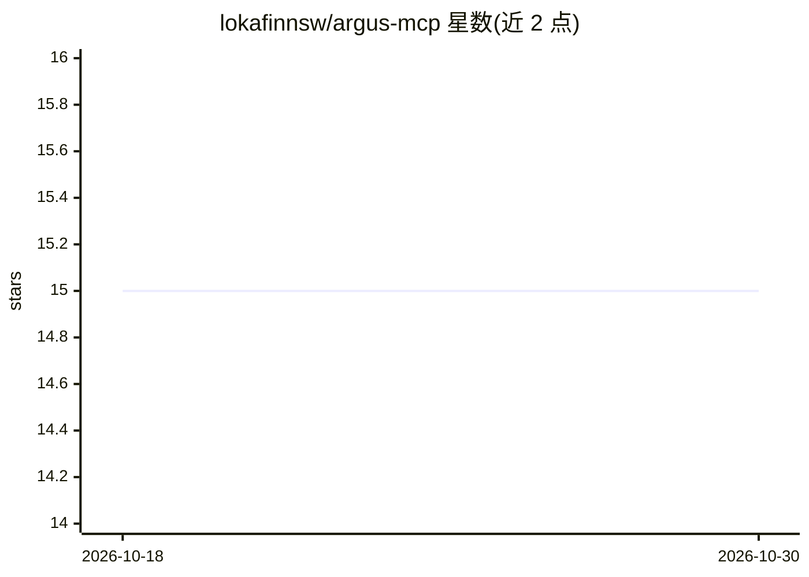

# lokafinnsw/argus-mcp

⭐ 15 · Python · MIT · 推送 2025-12-25 · [GitHub](https://github.com/lokafinnsw/argus-mcp) · 个人维护 · 中文 README

**面向 MCP 客户端的 AI 代码审查服务器**

基于 Model Context Protocol 的代码审查服务器：在 Windsurf、Claude Desktop、Cursor 等 MCP 客户端中以自然语言触发审查，自动根据 IDE 上下文选择单文件、Git diff 或多文件三种模式，调用 GLM 4.7、Gemini 3 Flash Preview、MiniMax M2.1 等模型进行分析，输出 Must Fix / Should Fix / Suggestions 分级报告。检查覆盖 OWASP 安全项、逻辑缺陷、性能与架构问题，支持 10+ 编程语言的专项检查，含 1 小时 TTL 缓存、指数退避重试与模型自动切换。安装方式为 git clone 源码加 venv 与 requirements.txt，需配置 GLM 或 OpenRouter 的 API key，要求 Python 3.11+。

## 筛选速览

| 维度 | 判定 | 备注 |
|---|---|---|
| AI 角色 | `ai-native` | 本体是模型或模型工具 |
| 许可风险 | `permissive` | MIT |
| 部署形态 | `library` | 以包/库形式分发 |
| 模型依赖 | locked-api |  |
| 硬件要求 | — | 无带数字的原话,不猜 |
| 安装摩擦 | `low` | 无编译、无系统依赖或容器化 |
| 成熟度 | — | 结构信号不足 |

## 能力要点

- 三种审查模式：单文件 / Git diff / 多文件跨文件分析
- 多模型支持：GLM 4.7、Gemini 3 Flash Preview、MiniMax M2.1，失败自动切换
- OWASP 安全检查、性能与架构审查，覆盖 10+ 语言
- 1 小时 TTL 缓存与指数退避重试

## 适用场景

- 在 IDE 里用自然语言触发提交前或 PR 的代码审查
- 获得带文件行号、修复建议的分级审查报告
- 按会话切换不同模型进行代码检查

## 场景标签

`代码审查` · 领域:编码与开发

## 证据(README 行号)

> L9: Argus MCP is a Model Context Protocol (MCP) server that provides rigorous code review through multiple AI models. Na
> L148: 1. **You write a command** - "Review my code" or "Check this file"
> L154: 4. **AI analyzes code** - Using language-specific checks

## 星数曲线

2026-10-18 15 → 2026-10-30 15（+0）

---
*卡片 v1 · prompt 1.4 · 生成 2026-10-30 · 置信度 mid · 依据 README sha `4ed89a9f79c8` · [字段定义](../../DATASET.md)*
