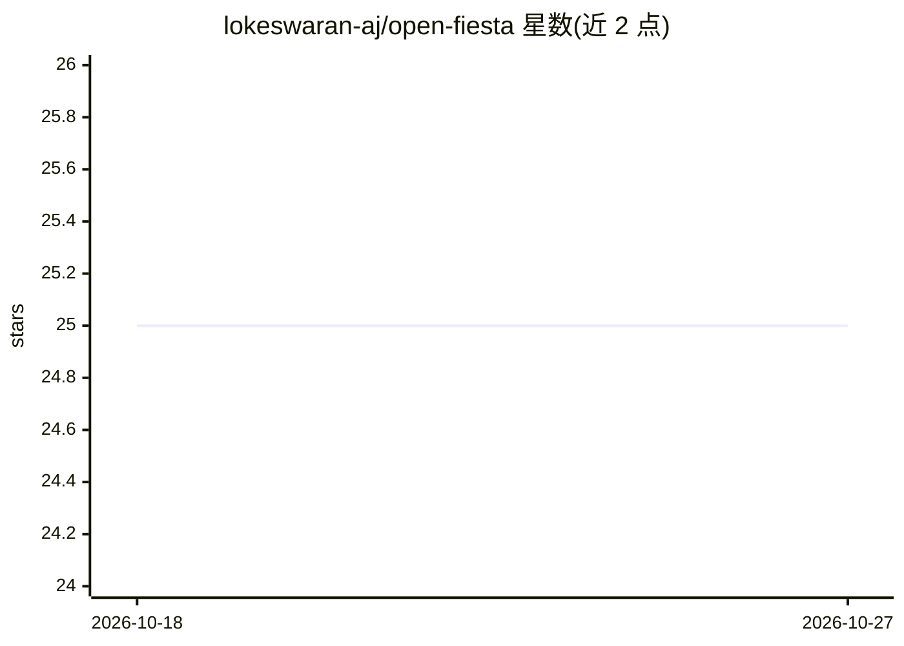

# lokeswaran-aj/open-fiesta

⭐ 25 · TypeScript · Apache-2.0 · 推送 2026-04-02 · [GitHub](https://github.com/lokeswaran-aj/open-fiesta) · [官网](https://open-fiesta.com) · 个人维护

**聚合 200+ 模型的多模型聊天应用：并排对比回复**

基于 Next.js/TypeScript/Vercel AI SDK 构建的 Web 聊天应用：通过 AIMLAPI、OpenRouter、Vercel AI Gateway 的 API Key 接入 200+ 模型（OpenAI、Claude、Gemini、Grok 等），支持并行对话与多模型回复实时流式对比。认证用 Better Auth，聊天历史存 Postgres；部分功能（模型参数设置、本地存储、导出分享）仍在路线图未实现，README 声明处于早期开发阶段。本地运行需 Node.js v20+、pnpm、Docker（数据库）。

## 筛选速览

| 维度 | 判定 | 备注 |
|---|---|---|
| AI 角色 | `ai-native` | 本体是模型或模型工具 |
| 许可风险 | `permissive` | Apache-2.0 |
| 部署形态 | `self-host` | docker 或自建部署 |
| 模型依赖 | locked-api |  |
| 硬件要求 | — | 无带数字的原话,不猜 |
| 安装摩擦 | `low` | 无编译、无系统依赖或容器化 |
| 成熟度 | `idea` | |

## 能力要点

- 多模型并行对话与回复并排实时对比
- 通过 AIMLAPI / OpenRouter / Vercel AI Gateway 接入 200+ 模型
- Better Auth 认证（GitHub/Google OAuth）与 Postgres 聊天历史持久化
- 基于 Vercel AI SDK、Shadcn UI、PromptKit 技术栈

## 适用场景

- 同一问题发给多个模型并排对比择优
- 在一个界面统一使用 OpenAI、Claude、Gemini、Grok 等各家模型
- 自部署带账号系统的多模型聊天平台

## 场景标签

 · 领域:LLM 应用/聊天客户端

## 证据(README 行号)

> L3: **Open Fiesta** is an AI chat application with 200+ AI models like OpenAI, Gemini, Claude, Perplexity, Deepseek, and
> L8: - [x] **Multi-model chat**: talk to ChatGPT, Claude, Gemini, Grok, etc. in parallel

## 星数曲线

2026-10-18 25 → 2026-10-27 25（+0）

---
*卡片 v1 · prompt 1.4 · 生成 2026-10-27 · 置信度 mid · 依据 README sha `6a4bd11205a3` · [字段定义](../../DATASET.md)*
