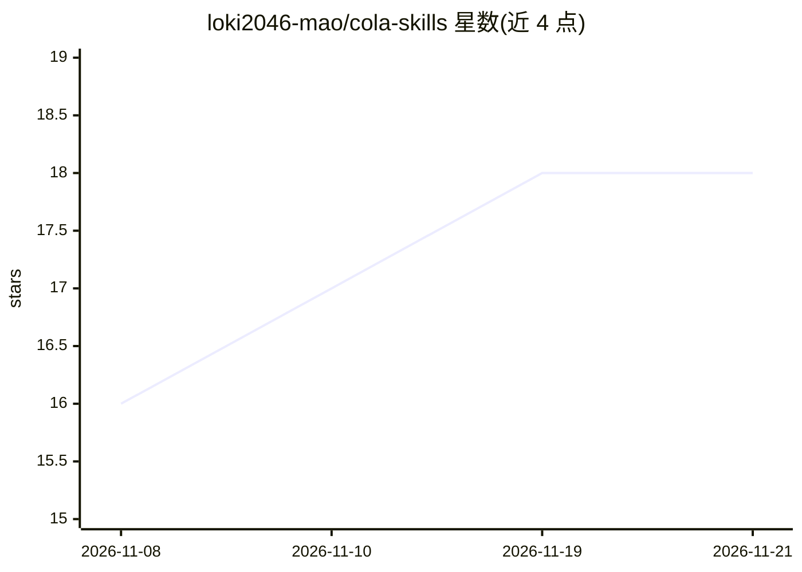

# loki2046-mao/cola-skills

⭐ 18 · HTML · MIT · 推送 2026-11-06 · [GitHub](https://github.com/loki2046-mao/cola-skills) · [官网](https://hiloki.ai/about) · 个人维护 · 中文 README

**赛博小熊猫 Loki 的个人 Cola Skill 集（12 个 Skill）**

由创作者 Loki 与 AI 协作整理、供 Cola 使用的个人 Skill 集合，含 12 个 Skill 目录，覆盖 HTML PPT 生成、社交图文、公众号全链路（写作→封面→排版→飞书发布）、品牌设计系统、Manim 数学动画视频管线、人生复盘、英语课件生成等场景，由 loki-design-system 作为共享品牌基础层被各视觉 Skill 引用。另推荐 12 项第三方 Skill（保留原作者归属，不包含在本仓库内）。README 明确声明目录数不等于已交付产品，部分 Skill 未完成运行验收。使用方式为克隆仓库到 ~/.cola/skills/ 目录。

## 筛选速览

| 维度 | 判定 | 备注 |
|---|---|---|
| AI 角色 | `ai-knowledge` | 知识聚合/清单类 |
| 许可风险 | `permissive` | MIT |
| 部署形态 | `None` |  |
| 模型依赖 | — | README 未给出锁定关系 |
| 硬件要求 | — | 无带数字的原话,不猜 |
| 安装摩擦 | `medium` | 含编译或系统依赖之一 |
| 成熟度 | `idea` | |

## 能力要点

- 12 个 Skill 目录，覆盖设计视觉、公众号、视频、教学复盘等 6 类场景
- loki-design-system 作为共享品牌基础层（SSOT）被视觉 Skill 引用
- manim-video-pipeline 含脚本→TTS→ASR→Manim→BGM→ffmpeg 管线
- 附 12 项第三方推荐 Skill 并保留原作者归属

## 适用场景

- 为 Cola 安装个人风格的内容创作 Skill（PPT/图文/公众号）
- 搭建个人品牌一致的多场景内容生产工作流
- 参考他人 Skill 的组织方式与适配做法

## 场景标签

`工作流自动化` `AI 写作` · 领域:效率与自动化

## 证据(README 行号)

> L3: > 这是 Loki 与 AI 协作整理、用于 Cola 的个人 Skill 集。当前仓库包含 **12 个 Skill 目录**（2026-11-06 核对，以顶层目录内的 `SKILL.md` 为准）。涵盖 PPT 生成、社交图文
> L60: 这些 Skill 是为 Cola 设计的。将 Skill 目录复制到 `~/.cola/skills/` 即可使用：

## 星数曲线

2026-11-08 16 → 2026-11-21 18（+2）

---
*卡片 v1 · prompt 1.4 · 生成 2026-11-18 · 置信度 high · 依据 README sha `f09513c4100c` · [字段定义](../../DATASET.md)*
