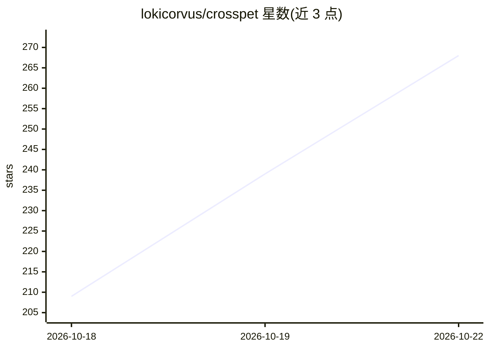

# lokicorvus/crosspet

⭐ 268 · C# · NOASSERTION · 推送 2026-10-21 · [GitHub](https://github.com/lokicorvus/crosspet) · [官网](https://github.com/lokicorvus/crosspet/releases/latest) · 个人维护 · 中文 README

**跨 AI 桌宠：随所用 AI 切换形象、跟随 AI 工作状态做动作**

面向消费者的桌面宠物应用：macOS 13+ / Windows 10+ 可用。内置 Claude、GPT、DeepSeek、Gemini、GLM、Qwen 等角色，用户切换到哪个 AI 应用就变成对应拟人形象；通过钩子或插件接入 Claude Code、Codex、DeepSeek Harness、Antigravity、ZCode、WorkBuddy、Hermes、Qwen Code 等，桌宠随思考、跑命令、出结果等工作事件换动作，并在名牌下显示额度/余额。支持多对话并行展示、峰谷时段换装、贴边隐藏与一键更新。代码 MIT，立绘 CC BY-NC-SA 4.0，非官方同人项目。

## 筛选速览

| 维度 | 判定 | 备注 |
|---|---|---|
| AI 角色 | `ai-enhanced` | 去掉 AI 部分产品仍成立 |
| 许可风险 | `none` | NOASSERTION |
| 部署形态 | `None` |  |
| 模型依赖 | — | README 未给出锁定关系 |
| 硬件要求 | — | 无带数字的原话,不猜 |
| 安装摩擦 | `low` | 无编译、无系统依赖或容器化 |
| 成熟度 | `idea` | |

## 能力要点

- 5+ 个 AI 角色，随前台 AI 应用自动换形象
- 通过钩子/插件接入 9 种 AI 工具并跟随工作状态做动作
- 显示 Claude/GPT/DeepSeek/Gemini 的额度与余额（不读登录凭据）
- 多对话并行小卡片、贴边隐藏、一键更新、自定义角色文件夹

## 适用场景

- 日常使用 AI 编程工具时有个桌宠陪伴并反映工作进度
- 在同一屏查看各家 AI 的剩余额度与峰谷时段
- 按文件夹自定义立绘、台词甚至新增角色

## 场景标签

 · 领域:桌面娱乐/AI 工具伴侣

## 证据(README 行号)

> L11: 一只浮在桌面角落的小桌宠，Mac 和 Windows 都能用。**你切到哪个 AI，她就变成哪个 AI 娘；AI 干什么活，她就跟着做什么动作。**
> L21: - **跟着 AI 干活**：思考、读文件、写代码、跑命令、上网查资料、画图、派子任务、出错、完成。每个状态都有一张立绘，身边配一个小动画（小终端、浏览器、画板、任务清单……）。一轮里用了 8 次以上工具的大活干完，她会戴上自己的
> L40: |AI|自动换形象|跟着干活|额度 / 余额|

## 星数曲线

2026-10-18 209 → 2026-10-22 268（+59）

---
*卡片 v1 · prompt 1.4 · 生成 2026-10-22 · 置信度 high · 依据 README sha `0d1f47654410` · [字段定义](../../DATASET.md)*
