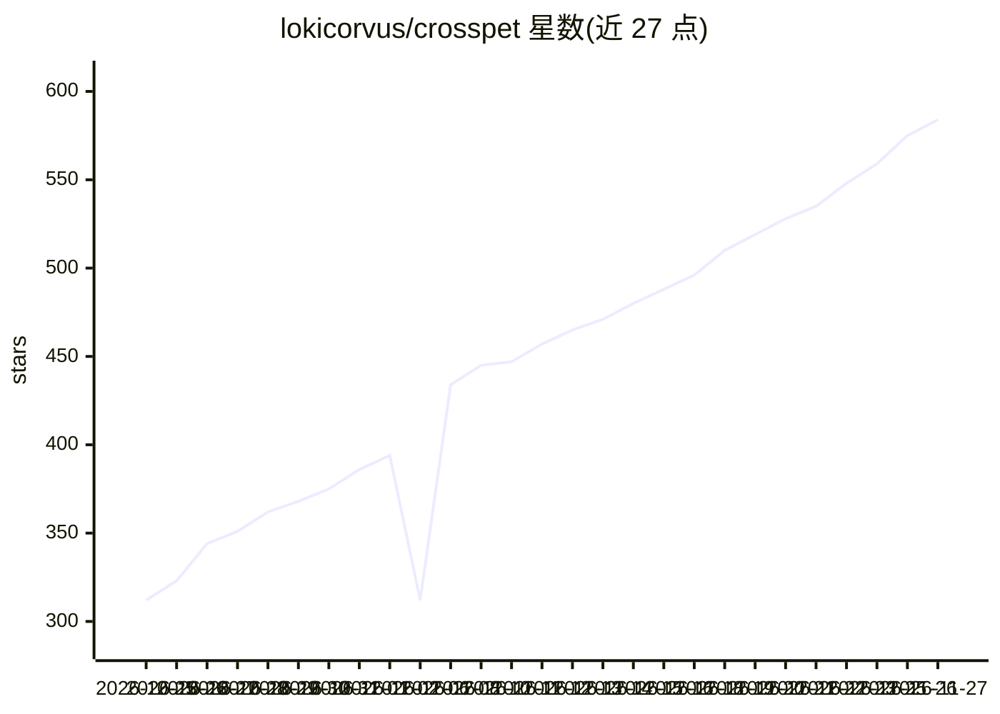

# lokicorvus/crosspet

⭐ 584 · JavaScript · NOASSERTION · 推送 2026-11-24 · [GitHub](https://github.com/lokicorvus/crosspet) · [官网](https://github.com/lokicorvus/crosspet/releases/latest) · 个人维护 · 中文 README

**跟着你所用 AI 换形象与动作的跨 AI 桌面宠物**

跨平台桌面宠物应用，通过钩子、mod、插件读取 Claude Code、Codex、DeepSeek Harness、Antigravity 等 AI 工具的本地事件：按当前使用的模型切换角色形象，并随 AI 的工作状态（思考、读文件、跑命令、等待授权等）播放对应动作与动画。还提供各家 AI 的额度/余额显示、多桌宠同时在场、互动（摸头、贴边、甩动）、久坐提醒、皮肤系统等。非官方同人项目，与各家 AI 公司无关；macOS 需 13+，Windows 需 10 (1903)+。

## 筛选速览

| 维度 | 判定 | 备注 |
|---|---|---|
| AI 角色 | `ai-enhanced` | 去掉 AI 部分产品仍成立 |
| 许可风险 | `none` | NOASSERTION |
| 部署形态 | `desktop` | 安装包/桌面程序 |
| 模型依赖 | locked-api |  |
| 硬件要求 | — | 无带数字的原话,不猜 |
| 安装摩擦 | `low` | 无编译、无系统依赖或容器化 |
| 成熟度 | — | 结构信号不足 |

## 能力要点

- 按当前 AI 工具与所用模型自动切换角色形象（Claude/GPT/DeepSeek/Gemini/GLM/Grok/千问/Kimi/豆包等）
- 通过钩子/mod/插件跟随 AI 工作状态播放动作（读文件、跑命令、等你回答等）
- 显示 Claude 5小时/每周额度、Codex 额度、DeepSeek 余额、Antigravity 额度
- 多桌宠：多个 AI 各出一只，角色间有友谊好感与对话系统

## 适用场景

- 用 Claude Code、Codex 等编程 AI 干活时在桌面角落看到工作状态
- 同时使用多个 AI 工具想在桌面上区分显示
- 想直观查看各家 AI 的额度与余额消耗

## 场景标签

 · 领域:桌面工具/娱乐

## 证据(README 行号)

> L11: 一只浮在桌面角落的小桌宠，Mac 和 Windows 都能用。**你切到哪个 AI，她就变成哪个 AI 娘；AI 干什么活，她就跟着做什么动作。**
> L21: - **跟着 AI 干活**：思考、读文件、写代码、跑命令、上网查资料、画图、派子任务、出错、完成。每个状态都有一张立绘，身边配一个小动画（小终端、浏览器、画板、任务清单……）。一轮里用了 8 次以上工具的大活干完，她会戴上自己的
> L47: |AI|自动换形象|跟着干活|额度 / 余额|

## 星数曲线

2026-10-25 312 → 2026-11-27 584（+272）

---
*卡片 v1 · prompt 1.4 · 生成 2026-11-26 · 置信度 high · 依据 README sha `af15c0348b38` · [字段定义](../../DATASET.md)*
