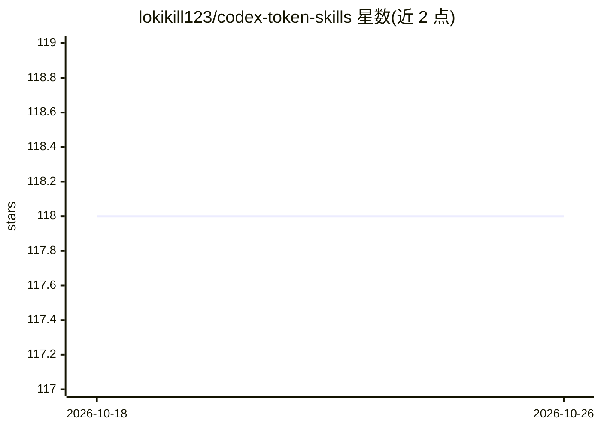

# lokikill123/codex-token-skills

⭐ 118 · MIT · 推送 2026-06-15 · [GitHub](https://github.com/lokikill123/codex-token-skills) · 个人维护 · 中文 README

**为 Codex CLI 提供省 token 与持久记忆的两个 skill**

面向使用 Codex CLI 与 DeepSeek V4 Pro 的开发者，提供两个 Codex skill：token-saver 按简单/复杂任务分模式约束输出长度（禁止 preamble、计划、解释等），README 称实测预计省 60-80% token；memory 用 MEMORY.md 文件跨对话恢复用户偏好、项目结构与已做决策，每次约消耗 800 token。核心机制是冻结 SKILL.md 文件以提升 DeepSeek 前缀缓存命中率。通过 git clone 复制到 ~/.codex/skills/ 或 skill-installer 安装。

## 筛选速览

| 维度 | 判定 | 备注 |
|---|---|---|
| AI 角色 | `ai-ecosystem` | LLM/agent 周边工具 |
| 许可风险 | `permissive` | MIT |
| 部署形态 | `None` |  |
| 模型依赖 | — | README 未给出锁定关系 |
| 硬件要求 | — | 无带数字的原话,不猜 |
| 安装摩擦 | `low` | 无编译、无系统依赖或容器化 |
| 成熟度 | — | 结构信号不足 |

## 能力要点

- token-saver 双模式：简单任务禁止 preamble/计划/解释，复杂任务严格受限
- memory 以 MEMORY.md 做跨对话持久记忆（约 800 token/次）
- 冻结 skill 文件以提升 DeepSeek 前缀缓存命中率

## 适用场景

- 降低 Codex CLI 日常使用的 token 消耗
- 上下文压缩后跨对话恢复项目记忆与用户偏好
- 提升 DeepSeek 前缀缓存命中率

## 场景标签

`Agent 记忆` · 领域:Agent 开发

## 证据(README 行号)

> L3: > 专为 **DeepSeek V4 Pro** 优化的 Codex skill，大幅降低 token 消耗并提升前缀缓存命中率。
> L25: Smart 双模式：
> L43: ```bash

## 星数曲线



2026-10-18 118 → 2026-10-26 118（+0）


---
*卡片 v1 · prompt 1.4 · 生成 2026-10-23 · 置信度 high · 依据 README sha `c0190595c193` · [字段定义](../../DATASET.md)*
