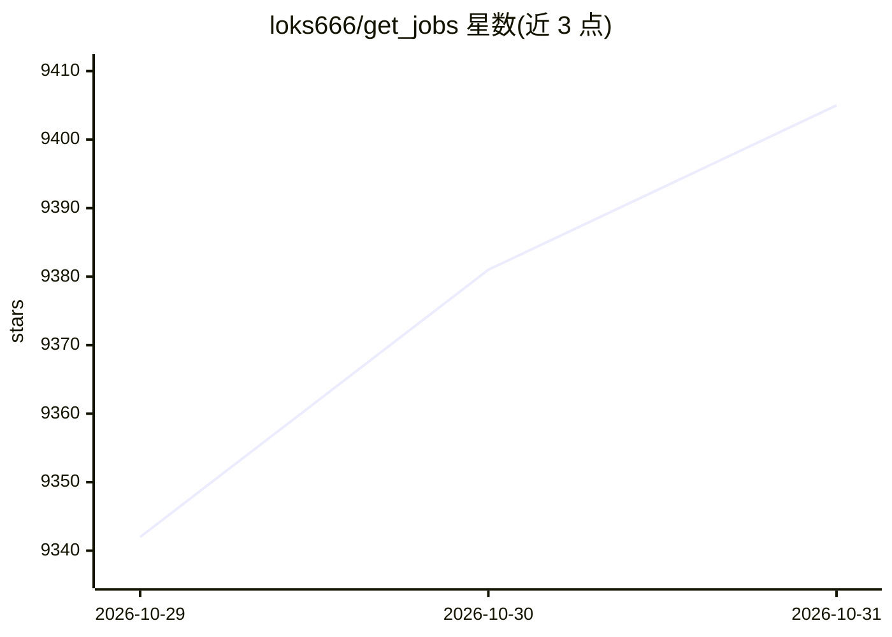

# loks666/get_jobs

⭐ 9,405 · Java · NOASSERTION · 推送 2026-10-28 · [GitHub](https://github.com/loks666/get_jobs) · [官网](https://loks666.github.io/get_jobs/) · 个人维护 · 中文 README

**面向求职者的多平台自动投简历工具，含 AI 岗位匹配与打招呼语生成**

基于 Spring Boot + Playwright + SQLite 后端与 Next.js/React 网页管理界面的求职投递自动化工具，通过浏览器自动化操作 Boss 直聘、猎聘等国内招聘平台，自动发送打招呼语与图片简历。AI 功能包括岗位匹配度检测和根据 JD 生成个性化打招呼语，通过 OpenAI 兼容接口调用（默认示例 gpt-5-nano）。51job、智联、拉钩三平台已停止维护。采用 PolyForm Noncommercial 1.0.0 协议，禁止商业使用。

## 筛选速览

| 维度 | 判定 | 备注 |
|---|---|---|
| AI 角色 | `ai-enhanced` | 去掉 AI 部分产品仍成立 |
| 许可风险 | `none` | NOASSERTION |
| 部署形态 | `None` |  |
| 模型依赖 | — | README 未给出锁定关系 |
| 硬件要求 | — | 无带数字的原话,不猜 |
| 安装摩擦 | `medium` | 含编译或系统依赖之一 |
| 成熟度 | `idea` | |

## 能力要点

- Boss 直聘与猎聘平台的自动投递与打招呼
- AI 检测岗位匹配度并按 JD 生成打招呼语（OpenAI 兼容接口）
- 自动过滤不活跃 HR、猎头岗位与目标薪资，自动更新企业黑名单
- 企业微信机器人实时推送投递情况

## 适用场景

- 我想在 Boss 直聘和猎聘上批量自动投递简历
- 让 AI 根据岗位 JD 帮我写个性化的打招呼语
- 投递结果通过企业微信实时收到通知

## 场景标签

`浏览器自动化` `AI 写作` · 领域:效率与自动化

## 证据(README 行号)

> L48: - **💥 AI 智能匹配**：AI检测岗位匹配度，并根据JD自动撰写个性化的打招呼语（仅限 Boss 直聘）。
> L108:       BASE_URL=https://api.openai.com

## 星数曲线

2026-10-29 9,342 → 2026-10-31 9,405（+63）

---
*卡片 v1 · prompt 1.4 · 生成 2026-10-28 · 置信度 high · 依据 README sha `79fabf9c432c` · [字段定义](../../DATASET.md)*
