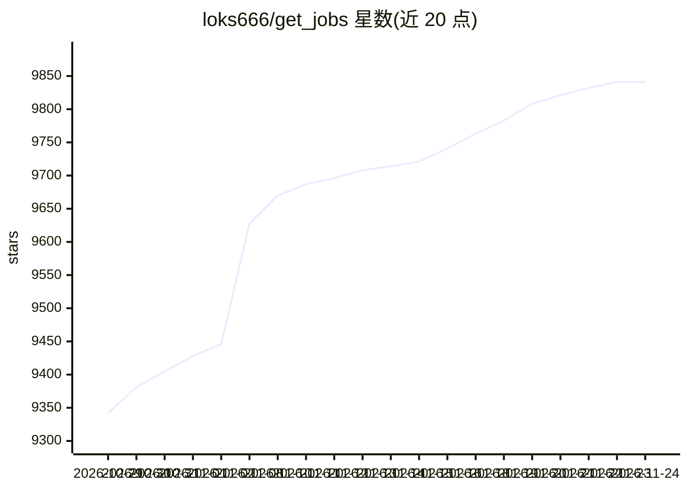

# loks666/get_jobs

⭐ 9,841 · Java · NOASSERTION · 推送 2026-11-12 · [GitHub](https://github.com/loks666/get_jobs) · [官网](https://loks666.github.io/get_jobs/) · 个人维护 · 中文 README

**自动投简历脚本：多平台求职投递工具**

基于 Spring Boot + Playwright + SQLite 的求职投递工具，面向国内求职者，覆盖 Boss直聘、猎聘、前程无忧、智联招聘四个平台的自动岗位投递。提供网页管理界面用于配置投递条件，AI 根据岗位 JD 检测匹配度并生成个性化打招呼语（限 Boss 直聘），支持自动过滤不活跃 HR、猎头岗位与目标薪资，通过企业微信推送投递通知，维护黑名单企业避免重复投递。需 JDK21 与 Gradle 环境，不支持服务器部署，须本机运行；51job、智联等平台已停止维护。

## 筛选速览

| 维度 | 判定 | 备注 |
|---|---|---|
| AI 角色 | `ai-enhanced` | 去掉 AI 部分产品仍成立 |
| 许可风险 | `none` | NOASSERTION |
| 部署形态 | `None` |  |
| 模型依赖 | — | README 未给出锁定关系 |
| 硬件要求 | — | 无带数字的原话,不猜 |
| 安装摩擦 | `medium` | 含编译或系统依赖之一 |
| 成熟度 | — | 结构信号不足 |

## 能力要点

- Playwright 驱动浏览器在四平台自动投递简历
- AI 检测岗位匹配度并生成个性化打招呼语（限 Boss 直聘）
- 自动过滤不活跃 HR、猎头岗位与目标薪资，维护黑名单企业
- 企业微信实时推送投递情况

## 适用场景

- 自动向 Boss 直聘、猎聘等平台批量投递简历
- 让 AI 根据 JD 生成打招呼语提高沟通效率
- 过滤不合适岗位并拉黑不投递的企业

## 场景标签

`浏览器自动化` · 领域:效率与自动化

## 证据(README 行号)

> L48: - **💥 AI 智能匹配**：AI检测岗位匹配度，并根据JD自动撰写个性化的打招呼语（仅限 Boss 直聘）。
> L191:  1. 本项目不支持服务器部署，无须尝试，如招聘网站发现访问者为服务器IP，不会返回任何网站数据。
> L78: ### 2️⃣ 环境配置:Gradle、JDK21

## 星数曲线

2026-10-29 9,342 → 2026-11-24 9,841（+499）

---
*卡片 v1 · prompt 1.4 · 生成 2026-11-22 · 置信度 high · 依据 README sha `13281b039398` · [字段定义](../../DATASET.md)*
