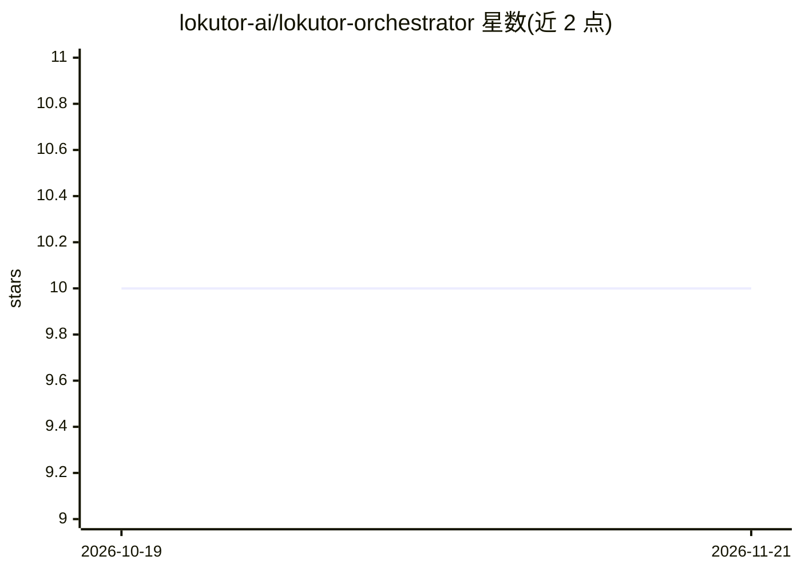

# lokutor-ai/lokutor-orchestrator

⭐ 10 · Go · MIT · 推送 2026-11-19 · [GitHub](https://github.com/lokutor-ai/lokutor-orchestrator) · [官网](https://www.lokutor.com) · 组织维护

**Go 语音代理编排库：串联 STT/LLM/TTS 实现低延迟对话**

以 Go 库形式发布的语音代理编排层，来自 Lokutor 公司开源的生产引擎。它将语音识别、语言模型与语音合成接入同一条低延迟会话流，处理轮次结束检测、打断（barge-in）、句中工具调用与回声抑制等环节。通过三个接口可接入任意供应商，支持供应商链故障切换、推测性回复、上下文预算与分阶段延迟统计、按 token 计量的会话计费。Turno 轮次检测模型权重不随本仓库分发。

## 筛选速览

| 维度 | 判定 | 备注 |
|---|---|---|
| AI 角色 | `ai-ecosystem` | LLM/agent 周边工具 |
| 许可风险 | `permissive` | MIT |
| 部署形态 | `None` |  |
| 模型依赖 | — | README 未给出锁定关系 |
| 硬件要求 | — | 无带数字的原话,不猜 |
| 安装摩擦 | `low` | 无编译、无系统依赖或容器化 |
| 成熟度 | — | 结构信号不足 |

## 能力要点

- 分层轮次结束检测：VAD + 文本词法检查 + 可选 Turno 模型
- Barge-in 打断与滑窗相关搜索的回声抑制
- NewChainLLM 供应商链在错误或首 token 缓慢时切换
- 分阶段延迟统计与按类别 token 计量的会话计费

## 适用场景

- 构建可被用户随时打断的语音对话代理
- 在多家 STT/LLM/TTS 供应商之间做组合与故障切换
- 在自有服务器或设备上部署语音代理并按 token 计费

## 场景标签

`语音 Agent` · 领域:对话与助手

## 证据(README 行号)

> L9: This is the orchestration layer that runs Lokutor's production voice agents, published as a Go library. It ties spee
> L41: |Language model|OpenAI, Anthropic, Google, Groq, Cerebras, OpenRouter, and chains of them|

## 星数曲线

2026-10-19 10 → 2026-11-21 10（+0）

---
*卡片 v1 · prompt 1.4 · 生成 2026-11-19 · 置信度 high · 依据 README sha `c250a553a92d` · [字段定义](../../DATASET.md)*
