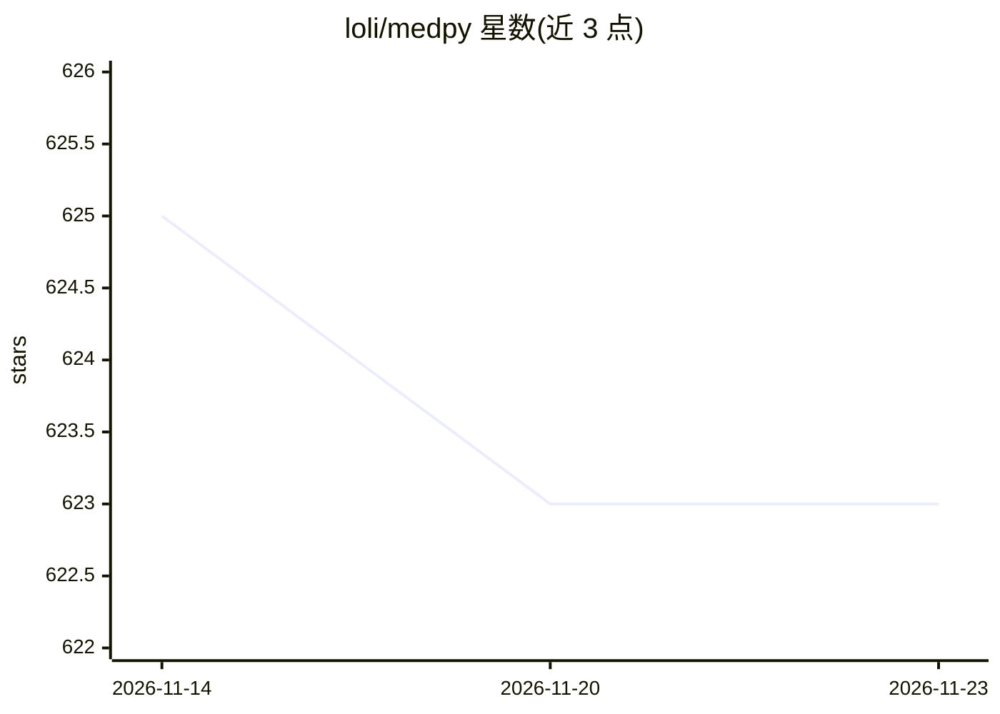

# loli/medpy

⭐ 623 · Jupyter Notebook · GPL-3.0 · 推送 2026-11-14 · [GitHub](https://github.com/loli/medpy) · [官网](http://loli.github.io/medpy/) · 个人维护

**面向医学高维图像的 Python 图像处理库与脚本集**

MedPy 是针对医学（高维）图像的图像处理库，附带一组处理脚本，支持医学影像常见处理任务（主题标签涉及图像分割、特征提取、图割、DICOM、CT 等）。以 Python 库形式发布于 PyPI 与 Conda-Forge，提供 HTML 文档、教程与 issue 跟踪。GPL v3 许可。Python 2 已停止支持，旧版本 <=0.3.0 仍可用；开发版本从 GitHub 获取。

## 筛选速览

| 维度 | 判定 | 备注 |
|---|---|---|
| AI 角色 | `ai-enhanced` | 去掉 AI 部分产品仍成立 |
| 许可风险 | `viral` | GPL-3.0 |
| 部署形态 | `library` | 以包/库形式分发 |
| 模型依赖 | — | README 未给出锁定关系 |
| 硬件要求 | — | 无带数字的原话,不猜 |
| 安装摩擦 | `low` | 无编译、无系统依赖或容器化 |
| 成熟度 | — | 结构信号不足 |

## 能力要点

- 针对医学高维图像的图像处理库与脚本集合
- 覆盖分割、特征提取、图割等医学影像处理任务
- 通过 PyPI 与 Conda-Forge 分发，附文档与教程
- 不再支持 Python 2，旧版 <=0.3.0 可用

## 适用场景

- 医学影像的分割与特征提取等处理流程
- 在 Python 项目中处理 DICOM/CT 等高维医学图像

## 场景标签

`图像视频处理` `目标检测` · 领域:感知与多模态

## 证据(README 行号)

> L12: MedPy is an image processing library and collection of scripts targeted towards medical (i.e. high dimensional) ima

## 星数曲线

2026-11-14 625 → 2026-11-23 623（-2）

---
*卡片 v1 · prompt 1.4 · 生成 2026-11-17 · 置信度 high · 依据 README sha `fe68ac253c2d` · [字段定义](../../DATASET.md)*
