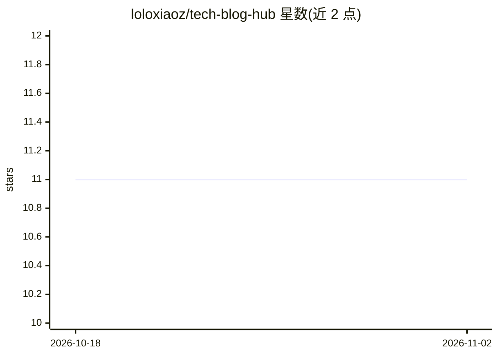

# loloxiaoz/tech-blog-hub

⭐ 11 · HTML · 推送 2026-07-08 · [GitHub](https://github.com/loloxiaoz/tech-blog-hub) · 个人维护 · 中文 README

**聚合 23 个 AI 大厂博客并生成中文静态学习站的工具**

以 Claude Code 技能形式提供的博客聚合与建站工具：覆盖 Anthropic、OpenAI、DeepSeek、Qwen 等 23 个国际与国内 AI 机构来源，流程为发现文章、抓取正文、调用 Claude API 翻译为中文，再用 Python 脚本生成纯静态 HTML 学习站（全文搜索、来源筛选、阅读进度标记），可离线 file:// 打开或部署到静态托管。建站脚本零依赖，抓取需 requests+beautifulsoup4，翻译需 anthropic 包与 API key，也提供无需网络的内置样例 Demo。

## 筛选速览

| 维度 | 判定 | 备注 |
|---|---|---|
| AI 角色 | `ai-enhanced` | 去掉 AI 部分产品仍成立 |
| 许可风险 | `none` | — |
| 部署形态 | `library` | 以包/库形式分发 |
| 模型依赖 | locked-api |  |
| 硬件要求 | — | 无带数字的原话,不猜 |
| 安装摩擦 | `low` | 无编译、无系统依赖或容器化 |
| 成熟度 | — | 结构信号不足 |

## 能力要点

- 23 个国际与国内 AI 机构博客源，抓取策略定义于 blogs.json
- Claude Code 技能可用自然语言驱动抓取、翻译与建站流程
- generate_site.py / harvest.py 零依赖（仅标准库），生成纯静态站点
- 支持 frontmatter 元数据（title/org/date/tags/source_url/summary）

## 适用场景

- 把英文大厂技术博客抓取并翻译成中文，离线阅读学习
- 从已有 Markdown 文章目录快速生成个人学习站
- 在 Claude Code 中用一句话完成抓取到建站的全流程

## 场景标签

`网页抓取` · 领域:效率与自动化

## 证据(README 行号)

> L8: 发现文章 → 抓取正文 → 翻译为中文 → 生成可离线浏览的静态学习站
> L146: - `generate_site.py` / `harvest.py`：**零依赖**（仅用标准库）
> L153: - 翻译功能（`--translate`）：需要 `anthropic` 包 + `ANTHROPIC_API_KEY`

## 星数曲线

2026-10-18 11 → 2026-11-02 11（+0）

---
*卡片 v1 · prompt 1.4 · 生成 2026-11-02 · 置信度 mid · 依据 README sha `a24ad627211d` · [字段定义](../../DATASET.md)*
