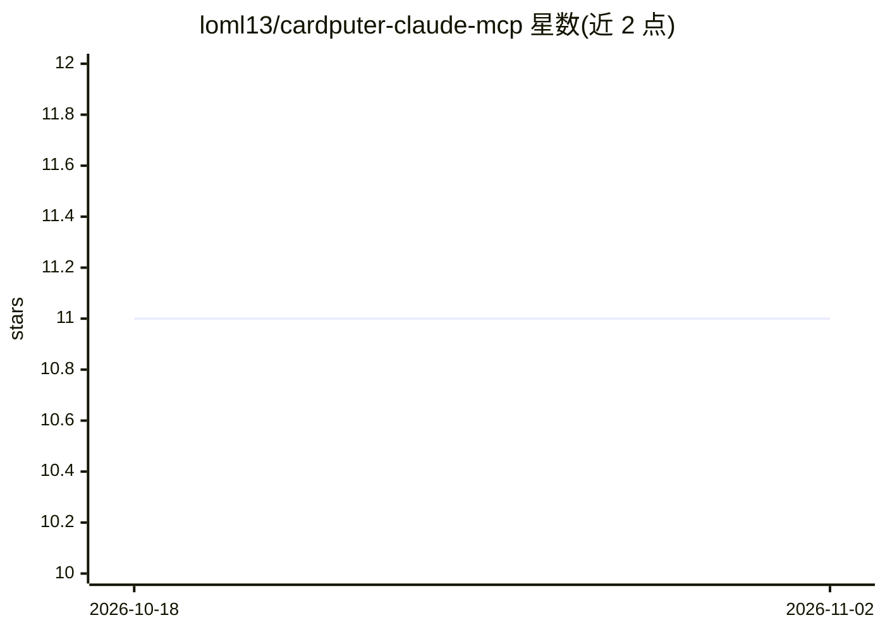

# loml13/cardputer-claude-mcp

⭐ 11 · Python · MIT · 推送 2026-06-11 · [GitHub](https://github.com/loml13/cardputer-claude-mcp) · 个人维护 · 中文 README

**M5Stack Cardputer 手持设备作为 AI 编码代理的物理审批面板**

由 MicroPython 设备端应用与 Mac 端 MCP 桥接组成：设备经 BLE GATT 与桥接通信，让 Claude Code 等代理能向手持设备推送通知、多选问题与需物理按键确认的审批；显示今日花费、5h/7d 订阅利用率与电池的常驻仪表盘；通过 Claude Code PreToolUse 钩子将 Bash 命令与文件编辑路由到设备审批，普通操作按 Enter、危险操作按 Y。设备不在场时回退终端提示。设备端应用需编译为 .mpy 并部署进 cardputer-claude-os 启动器框架。

## 筛选速览

| 维度 | 判定 | 备注 |
|---|---|---|
| AI 角色 | `ai-ecosystem` | LLM/agent 周边工具 |
| 许可风险 | `permissive` | MIT |
| 部署形态 | `library` | 以包/库形式分发 |
| 模型依赖 | — | README 未给出锁定关系 |
| 硬件要求 | — | 无带数字的原话,不猜 |
| 安装摩擦 | `low` | 无编译、无系统依赖或容器化 |
| 成熟度 | — | 结构信号不足 |

## 能力要点

- 代理的 shell 命令与文件编辑经设备物理按键审批（Enter/Y 分级）
- 常驻使用率仪表盘（今日花费 + 5h/7d 订阅利用率 + 电池）
- BLE 可配置共享密钥并以 HMAC-SHA256 签名确认应答
- 无头会话中设备不可达时：轻审批放行、危险审批拒绝

## 适用场景

- 让 AI 编码代理的危险命令和文件编辑需实体按键确认才执行
- 在桌面常显设备上查看 Claude Code 的用量与订阅利用率
- 通过提示注入无法伪造的物理按键为不可逆操作提供信任锚点

## 场景标签

`LLM 可观测性` · 领域:评测与运维

## 证据(README 行号)

> L10: A small MicroPython app on the handheld talks over BLE to a Mac-side MCP
> L17: - **gate the shell** — a Claude Code hook routes Bash commands *and* file

## 星数曲线

2026-10-18 11 → 2026-11-02 11（+0）

---
*卡片 v1 · prompt 1.4 · 生成 2026-11-02 · 置信度 high · 依据 README sha `54d69c95ec08` · [字段定义](../../DATASET.md)*
