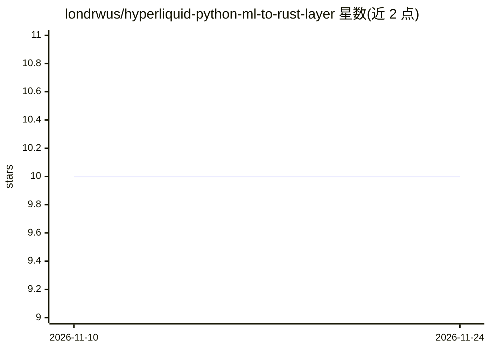

# londrwus/hyperliquid-python-ml-to-rust-layer

⭐ 10 · Rust · MIT · 推送 2026-07-28 · [GitHub](https://github.com/londrwus/hyperliquid-python-ml-to-rust-layer) · 个人维护

**让量化策略用 Python 编写、由 Rust 执行的交易执行层**

面向量化交易者的 ML 执行层：策略与模型保留在 Python 侧（pandas、scikit-learn、XGBoost、PyTorch），决策通过无锁队列以定长记录传给 Rust 执行核心下单。Rust 核心提供可预测时序、快速撤单、不可绕过的风控检查（仓位限额、速率上限、kill switch）与回测/实盘共用同一代码路径；特征在两侧逐位比对以防止研究与生产行为不一致。核心与交易所解耦，Hyperliquid 是首个适配器，Binance 适配器已在代码树中。仅在测试网验证过，未用真实资金交易。

## 筛选速览

| 维度 | 判定 | 备注 |
|---|---|---|
| AI 角色 | `ai-enhanced` | 去掉 AI 部分产品仍成立 |
| 许可风险 | `permissive` | MIT |
| 部署形态 | `None` |  |
| 模型依赖 | — | README 未给出锁定关系 |
| 硬件要求 | — | 无带数字的原话,不猜 |
| 安装摩擦 | `low` | 无编译、无系统依赖或容器化 |
| 成熟度 | `idea` | |

## 能力要点

- Python↔Rust 经无锁队列传递定长决策记录
- 风控检查强制内嵌：仓位限额、速率上限、kill switch，无绕过路径
- 特征逐位一致性校验，模型保持全精度不量化
- 1,885 个自动化测试（1,196 Rust + 689 Python），不触网

## 适用场景

- 用 Python 写 ML 策略并接入 Hyperliquid 测试网执行
- 需要回测与实盘走同一执行代码路径的交易系统
- 研究交易执行层 Python/Rust 边界的设计

## 场景标签

`金融量化` · 领域:学习与行业

## 证据(README 行号)

> L3: **Write your trading strategy in Python. Let Rust execute it.**
> L5: You keep pandas, scikit-learn, XGBoost and PyTorch. You never rewrite a model in Rust.
> L69: |🛡️ **Risk checks nothing can skip**|Every order crosses position limits, rate caps and a kill switch. No bypass ex

## 星数曲线

2026-11-10 10 → 2026-11-24 10（+0）

---
*卡片 v1 · prompt 1.4 · 生成 2026-11-19 · 置信度 mid · 依据 README sha `50b621d99de0` · [字段定义](../../DATASET.md)*
