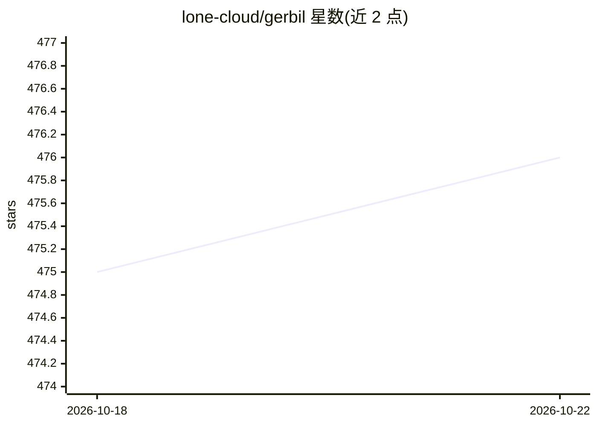

# lone-cloud/gerbil

⭐ 476 · TypeScript · AGPL-3.0 · 推送 2026-10-20 · [GitHub](https://github.com/lone-cloud/gerbil) · 个人维护

**本地运行 LLM 与图像生成的跨平台桌面应用**

基于 Electron 的桌面应用，内置 KoboldCpp（llama.cpp 分支）作为后端，在用户本机离线运行大语言模型与图像生成，支持 CPU 与 CUDA/ROCm/Vulkan/Metal GPU 加速。提供 HuggingFace 站内搜索下载 GGUF 模型、Flux/Qwen Image 等图像工作流预设、SillyTavern 与 OpenWebUI 集成，以及暴露 80+ KoboldCpp 参数的高级配置和 CLI 模式。提供 Windows/macOS/Linux 预编译安装包与 AUR 包，无遥测与账号。

## 筛选速览

| 维度 | 判定 | 备注 |
|---|---|---|
| AI 角色 | `ai-native` | 本体是模型或模型工具 |
| 许可风险 | `viral` | AGPL-3.0 |
| 部署形态 | `desktop` | 安装包/桌面程序 |
| 模型依赖 | local-ok | 支持本地模型 |
| 硬件要求 | `cpu-ok` | |
| 安装摩擦 | `medium` | 含编译或系统依赖之一 |
| 成熟度 | — | 结构信号不足 |

## 能力要点

- 内置 KoboldCpp 后端，本地运行 LLM 文本生成
- 图像生成预设：Flux、Chroma、Qwen Image、Z-Image
- 站内 HuggingFace 搜索与 GGUF 模型下载
- CLI 模式与 80+ KoboldCpp 高级参数暴露

## 适用场景

- 在本机离线运行大语言模型进行文本对话与创作
- 本地跑图像生成工作流（Flux、Qwen Image 等）
- 从应用内直接搜索并下载 HuggingFace 的 GGUF 模型

## 场景标签

`聊天机器人` `图像生成` · 领域:对话与助手

## 证据(README 行号)

> L5: **Local text and image generation, on your own hardware**
> L17: - **Run LLMs locally** - Powered by KoboldCpp, a fork of llama.cpp

## 星数曲线

2026-10-18 475 → 2026-10-22 476（+1）

---
*卡片 v1 · prompt 1.4 · 生成 2026-10-21 · 置信度 mid · 依据 README sha `6733705feff1` · [字段定义](../../DATASET.md)*
