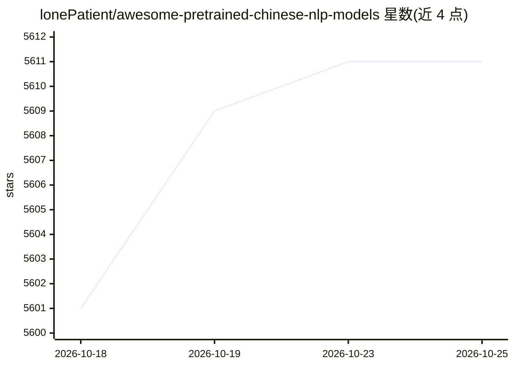

# lonePatient/awesome-pretrained-chinese-nlp-models

⭐ 5,611 · Python · MIT · 推送 2026-08-30 · [GitHub](https://github.com/lonePatient/awesome-pretrained-chinese-nlp-models) · 个人维护 · 中文 README

**中文预训练模型与大模型策展清单：收录模型条目与配套资源**

由个人维护的中文 NLP 模型聚合清单：按基础大模型、垂直领域大模型、对话大模型、多模态大模型、推理大模型、Embedding 及 NLU/NLG/多模态预训练系列分类收录模型条目，条目含参数量、架构、发布时间、机构与 HuggingFace/ModelScope 下载链接；另收录大模型评估基准、开源模型库平台、数据集库与其他 Awesome 清单。仓库提供 HuggingFace 国内镜像 hf-mirror.com 下载建议，并附更新日志持续追加条目。

## 筛选速览

| 维度 | 判定 | 备注 |
|---|---|---|
| AI 角色 | `ai-knowledge` | 知识聚合/清单类 |
| 许可风险 | `permissive` | MIT |
| 部署形态 | `None` |  |
| 模型依赖 | — | README 未给出锁定关系 |
| 硬件要求 | — | 无带数字的原话,不猜 |
| 安装摩擦 | `low` | 无编译、无系统依赖或容器化 |
| 成熟度 | — | 结构信号不足 |

## 能力要点

- 按 7+ 类别组织的大模型与预训练模型条目表（含参数/架构/机构/下载链接）
- 收录 7 个大模型评估基准与 4 个开源模型库平台介绍
- 收录中文预训练语料与多语言数据集库列表
- 提供 HuggingFace 国内镜像 hf-mirror.com 下载建议

## 适用场景

- 查找可下载的中文大模型或领域模型及其项目地址
- 对比中文预训练模型在 NLU/NLG/多模态各系列的覆盖
- 查找中文大模型评估基准与预训练语料数据集

## 场景标签

`精选清单` · 领域:学习与行业

## 证据(README 行号)

> L5: 在自然语言处理领域中，预训练语言模型（Pretrained Language Models）已成为非常重要的基础技术，本仓库主要收集目前网上公开的一些高质量中文预训练模型、中文多模态模型、中文大语言模型等内容(感谢分享资源的大佬)，
> L13: ### 🤖 大模型系列

## 星数曲线

2026-10-18 5,601 → 2026-10-25 5,611（+10）

---
*卡片 v1 · prompt 1.4 · 生成 2026-10-20 · 置信度 high · 依据 README sha `ccc6d0d81547` · [字段定义](../../DATASET.md)*
