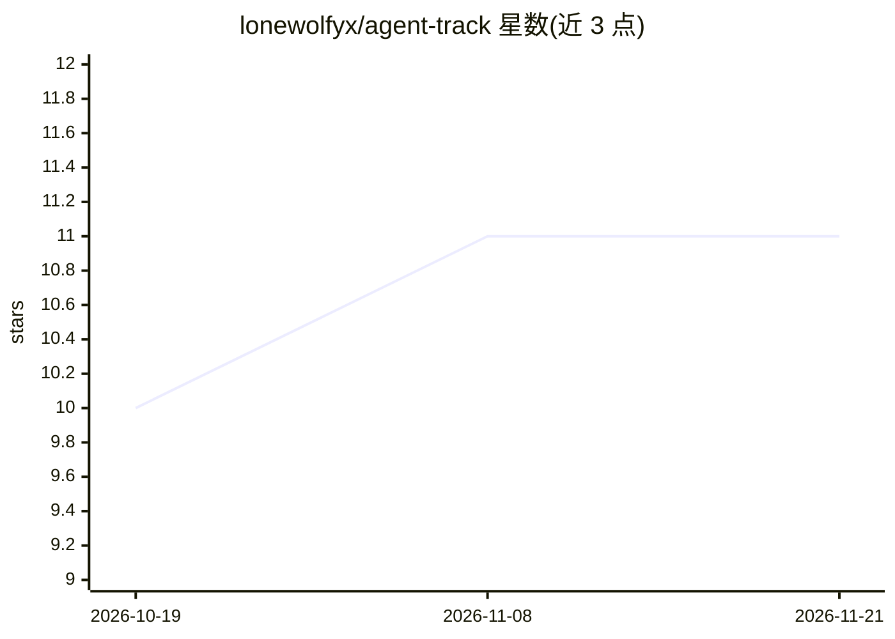

# lonewolfyx/agent-track

⭐ 11 · Vue · MIT · 推送 2026-07-08 · [GitHub](https://github.com/lonewolfyx/agent-track) · 个人维护

**可视化追踪单个 Agent/Codex 会话执行轨迹的轻量 CLI**

读取本地 Agent/Codex 会话生成的 jsonl 数据，以更直观的方式呈现单次会话的执行流程：用户提问与最终回答、推理步骤与中间消息、工具调用及其输出、token 用量与会话元数据。定位为会话回顾、Agent 工作流调试与调用链可视化工具，面向需要理解任务实际完成过程的开发者与团队。通过 npx 直接运行，采用 MIT 许可。

## 筛选速览

| 维度 | 判定 | 备注 |
|---|---|---|
| AI 角色 | `ai-ecosystem` | LLM/agent 周边工具 |
| 许可风险 | `permissive` | MIT |
| 部署形态 | `library` | 以包/库形式分发 |
| 模型依赖 | — | README 未给出锁定关系 |
| 硬件要求 | — | 无带数字的原话,不猜 |
| 安装摩擦 | `low` | 无编译、无系统依赖或容器化 |
| 成熟度 | — | 结构信号不足 |

## 能力要点

- 解析本地会话的 jsonl 数据并可视化呈现
- 展示推理步骤、工具调用及输出、token 用量
- npx 一条命令即可运行

## 适用场景

- 调试 Agent 工作流时回放单次会话的执行过程
- 查看工具调用链与各步骤输出
- 团队回顾某次任务是如何被完成的

## 场景标签

`LLM 可观测性` · 领域:评测与运维

## 证据(README 行号)

> L6: `agent-track` is a lightweight visualization and tracing tool for local Agent / Codex sessions, designed to help you
> L15: It is well suited for session review, Agent workflow debugging, call-chain visualization, and helping teams underst

## 星数曲线

2026-10-19 10 → 2026-11-21 11（+1）

---
*卡片 v1 · prompt 1.4 · 生成 2026-11-18 · 置信度 high · 依据 README sha `cd8cb517515e` · [字段定义](../../DATASET.md)*
