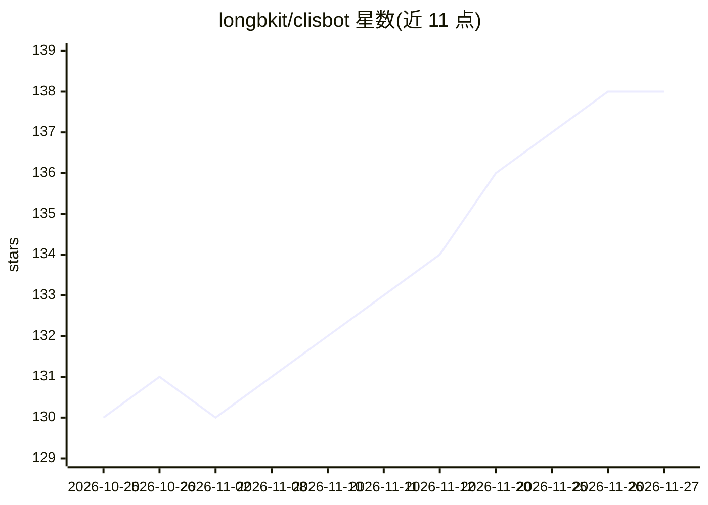

# longbkit/clisbot

⭐ 138 · TypeScript · NOASSERTION · 推送 2026-11-26 · [GitHub](https://github.com/longbkit/clisbot) · [官网](https://github.com/longbkit/clisbot) · 个人维护

**个人与团队的 AI 编码代理工作区与跨渠道聊天机器人**

Clisbot 由本地 daemon 管理编码代理，桌面、移动、Web 与 CLI 客户端连接同一工作区；可在分屏界面编辑文件、查看 diff、开 PR、运行终端，并让多个代理在各自 worktree 并行工作、相互通信。代理运行在用户自己的机器上，使用既有订阅或 API key；支持自建机器人、群组协作、语音模式，以及 Slack/Telegram/Zalo 渠道接入；企业场景提供 Hub 管理的主机与访问控制。需至少安装并配置一个 agent CLI（如 Claude Code、Codex）。

## 筛选速览

| 维度 | 判定 | 备注 |
|---|---|---|
| AI 角色 | `ai-ecosystem` | LLM/agent 周边工具 |
| 许可风险 | `none` | NOASSERTION |
| 部署形态 | `desktop` | 安装包/桌面程序 |
| 模型依赖 | — | README 未给出锁定关系 |
| 硬件要求 | — | 无带数字的原话,不猜 |
| 安装摩擦 | `low` | 无编译、无系统依赖或容器化 |
| 成熟度 | — | 结构信号不足 |

## 能力要点

- 并行代理：每个代理在独立 worktree 中运行，可跨 provider 互相调用与编排
- 40+ 代理选项：内置 Claude Code、Codex、Copilot、OpenCode、Pi 等，另有 39 个 ACP 目录预设
- 跨设备：桌面（Electron）、iOS/Android beta、Web 与 CLI 连接同一 daemon
- 提供 TypeScript SDK 与插件系统（UI、代理生命周期、provider 扩展）

## 适用场景

- 在一个桌面工作区里完成从规划、实现、测试到评审的软件工程流程
- 把编码 CLI 变成代理，在 Slack/Telegram/Zalo 里委派和跟踪任务
- 在服务器或 VM 上自托管 daemon，团队按成员与主机做访问控制
- 让多个不同模型的机器人组成群组协作讨论并互相评审

## 场景标签

`编码 Agent` `聊天机器人` `多智能体` · 领域:Agent 开发

## 证据(README 行号)

> L87: Clisbot runs a local server called the daemon that manages your coding agents. Clients like the desktop app, mobile
> L54: Clisbot combines Paseo's cross-device agent workspace with OpenClaw's channel integrations and native channel capab
> L43: - **Freedom to choose:** 40+ agent options: Claude Code, Codex, Copilot, OpenCode, Pi, Antigravity, and Muse Code a

## 星数曲线

2026-10-25 130 → 2026-11-27 138（+8）

---
*卡片 v1 · prompt 1.4 · 生成 2026-11-27 · 置信度 high · 依据 README sha `4eaa7358a0ea` · [字段定义](../../DATASET.md)*
