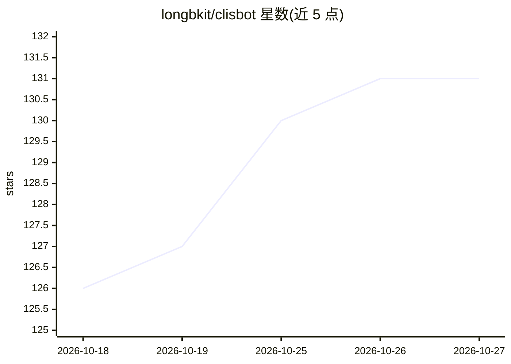

# longbkit/clisbot

⭐ 131 · TypeScript · NOASSERTION · 推送 2026-10-26 · [GitHub](https://github.com/longbkit/clisbot) · [官网](https://github.com/longbkit/clisbot) · 个人维护

**自托管的跨设备 AI 编码代理工作区与聊天机器人平台**

由本地 daemon 管理编码代理 CLI（Claude Code、Codex、Copilot 等）的工作区应用：支持并行代理各自 worktree、代理间编排、自托管运行于用户机器。提供桌面应用、移动端、Web 与 CLI 客户端连接 daemon，可将代理接入 Slack/Telegram/Zalo 等渠道并自建多代理群组协作。含插件系统、TypeScript SDK 与 Docker 部署方式；需预装至少一个代理 CLI 并配置凭据。作者为企业 CTO，面向个人与团队/企业场景，基于 Paseo 与 OpenClaw 代码构建。

## 筛选速览

| 维度 | 判定 | 备注 |
|---|---|---|
| AI 角色 | `ai-ecosystem` | LLM/agent 周边工具 |
| 许可风险 | `none` | NOASSERTION |
| 部署形态 | `desktop` | 安装包/桌面程序 |
| 模型依赖 | locked-api |  |
| 硬件要求 | — | 无带数字的原话,不猜 |
| 安装摩擦 | `low` | 无编译、无系统依赖或容器化 |
| 成熟度 | — | 结构信号不足 |

## 能力要点

- daemon 统一管理代理，桌面/移动/Web/CLI 客户端连接
- 并行代理运行于独立 worktree，代理间可相互启动与通信
- 40+ 代理选项（Claude Code、Codex、Copilot 等内置）
- 插件系统与 @clisbot/client TypeScript SDK

## 适用场景

- 在本机自托管运行编码代理并跨设备接入
- 把代理接入 Slack/Telegram 等沟通渠道处理任务
- 组建多代理群组协作完成编码与办公任务

## 场景标签

`编码 Agent` `聊天机器人` `多智能体` · 领域:Agent 开发

## 证据(README 行号)

> L80: Clisbot runs a local server called the daemon that manages your coding agents. Clients like the desktop app, mobile
> L38: - **Freedom to choose:** 40+ agent options: Claude Code, Codex, Copilot, OpenCode, Pi, Antigravity, and Muse Code a
> L47: Clisbot combines Paseo's cross-device agent workspace with OpenClaw's channel integrations and native channel capab

## 星数曲线

2026-10-18 126 → 2026-10-27 131（+5）

---
*卡片 v1 · prompt 1.4 · 生成 2026-10-23 · 置信度 high · 依据 README sha `4808a283bdd4` · [字段定义](../../DATASET.md)*
