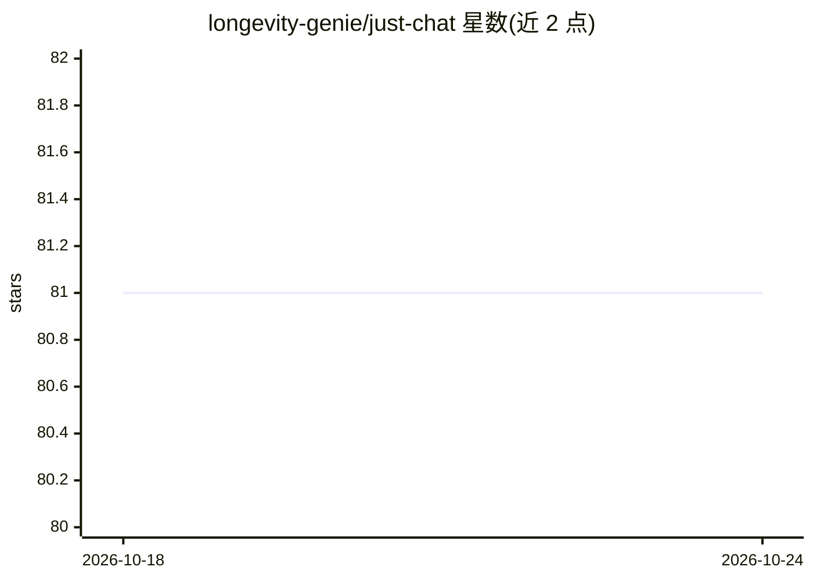

# longevity-genie/just-chat

⭐ 81 · Python · Apache-2.0 · 推送 2025-11-22 · [GitHub](https://github.com/longevity-genie/just-chat) · 组织维护

**一条命令启动的可定制 LLM Agent 聊天应用**

容器化部署的聊天应用：通过 docker-compose 或 podman 一键启动，在浏览器 localhost:3000 与自定义 Agent 对话。Agent 由 YAML 配置文件（chat_agent_profiles.yaml）定义人格与能力，可通过 /agent_tools/ 目录添加 Python 工具扩展功能。基于 just-agents 库初始化，支持 DeepSeek Reasoner、ChatGPT、LLAMA3.3 等多种模型，默认提供免费 Groq key（速率受限）。另集成 MeiliSearch 语义搜索，支持索引 markdown 文档供 Agent 引用，并提供索引 dump 的导入导出工具。系统无需本地 Python 或 Node.js，仅要求 Docker 或 Podman。

## 筛选速览

| 维度 | 判定 | 备注 |
|---|---|---|
| AI 角色 | `ai-native` | 本体是模型或模型工具 |
| 许可风险 | `permissive` | Apache-2.0 |
| 部署形态 | `self-host` | docker 或自建部署 |
| 模型依赖 | locked-api |  |
| 硬件要求 | — | 无带数字的原话,不猜 |
| 安装摩擦 | `low` | 无编译、无系统依赖或容器化 |
| 成熟度 | — | 结构信号不足 |

## 能力要点

- docker-compose / podman 一键启动，浏览器聊天界面
- YAML 配置 Agent 人格与能力，Python 工具目录扩展功能
- 基于 just-agents 支持 DeepSeek / ChatGPT / LLAMA3.3 等模型，默认免费 Groq key
- MeiliSearch 语义搜索索引文档供 Agent 检索引用，含 dump 备份导入导出工具

## 适用场景

- 快速搭建一个可对话的自定义 LLM Agent
- 为 Agent 挂载 Python 工具与本地知识库做问答
- 在不安装 Python/Node.js 的机器上运行聊天 Agent 服务

## 场景标签

`聊天机器人` `文档问答` · 领域:对话与助手

## 证据(README 行号)

> L14: And the chat with your agent is ready to go! Open `http://localhost:3000` in your browser and start chatting with y
> L35: - 🤖 Customize your AI assistant using a YAML file (can be edited with a text editor)
> L37: - 🌐 Talk with agent with a chat web interface at 0.0.0.0:3000

## 星数曲线

2026-10-18 81 → 2026-10-24 81（+0）

---
*卡片 v1 · prompt 1.4 · 生成 2026-10-24 · 置信度 mid · 依据 README sha `b43a413b13ab` · [字段定义](../../DATASET.md)*
