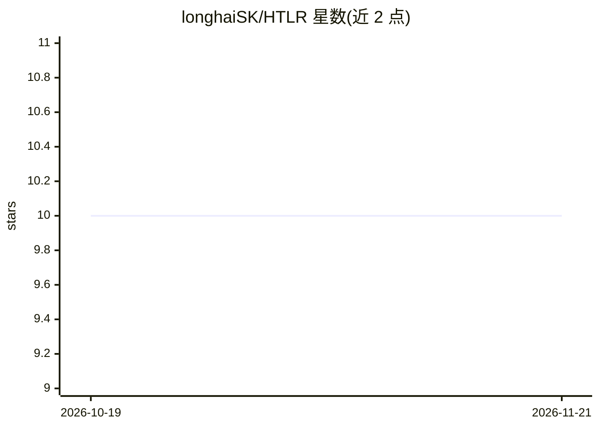

# longhaiSK/HTLR

⭐ 10 · R · GPL-3.0 · 推送 2026-10-26 · [GitHub](https://github.com/longhaiSK/HTLR) · [官网](https://longhaisk.github.io/HTLR) · 组织维护

**R 包：重尾先验的贝叶斯逻辑回归，用于高维分类与特征选择**

HTLR 是一个 R 包，通过拟合基于重尾先验的多项逻辑回归模型执行分类与特征选择。后验采样结合 restricted Gibbs sampling 与 Hamiltonian Monte Carlo，以应对高维和系数间高相关性。README 指出该包适用于基因表达谱等高维特征的分类任务，并使用 Armadillo 库执行矩阵运算，可通过替换 BLAS 库（ATLAS/OpenBLAS/Intel MKL）获得加速。提供 CRAN 安装与 GitHub 开发版安装。配套 2018 年发表的论文。

## 筛选速览

| 维度 | 判定 | 备注 |
|---|---|---|
| AI 角色 | `ai-native` | 本体是模型或模型工具 |
| 许可风险 | `viral` | GPL-3.0 |
| 部署形态 | `None` |  |
| 模型依赖 | — | README 未给出锁定关系 |
| 硬件要求 | — | 无带数字的原话,不猜 |
| 安装摩擦 | `low` | 无编译、无系统依赖或容器化 |
| 成熟度 | — | 结构信号不足 |

## 能力要点

- 基于重尾先验（Hyper-LASSO）的多分类逻辑回归
- restricted Gibbs sampling + HMC 的后验采样机制
- 面向高维特征的分类与特征选择
- 基于 Armadillo 的矩阵运算，可替换 BLAS 加速

## 适用场景

- 对基因表达谱等高维数据做分类
- 在大量无用特征中筛选少量有用特征
- 处理大量相关特征时的自动变量选择

## 场景标签

 · 领域:机器学习/统计建模

## 证据(README 行号)

> L10: *HTLR* performs classification and feature selection by fitting Bayesian
> L13: suitable for classification with high-dimensional features, such as gene

## 星数曲线

2026-10-19 10 → 2026-11-21 10（+0）

---
*卡片 v1 · prompt 1.4 · 生成 2026-11-19 · 置信度 high · 依据 README sha `155461588023` · [字段定义](../../DATASET.md)*
