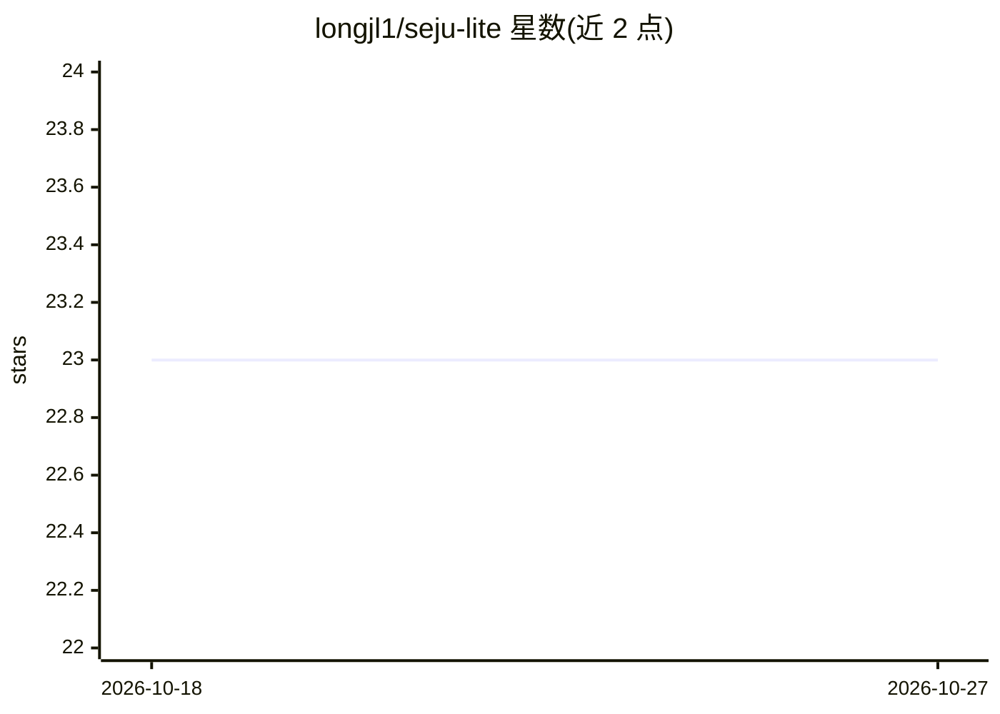

# longjl1/seju-lite

⭐ 23 · Python · 推送 2026-04-28 · [GitHub](https://github.com/longjl1/seju-lite) · [官网](https://seju-lite.vercel.app) · 个人维护 · 中文 README

**轻量级个人助理多 agent 运行时/框架**

seju-lite 是一个 Python 3.11+ 的轻量级多 agent 运行时，以 seju.neo 为产品化身份。提供两级路由（WorkflowOrchestrator 选 agent、AgentOrchestrator 分发）、规则+可选 LLM planner 的路由、内置工具与 MCP 客户端/服务器、短期/长期记忆整合（sessions.json 与 MEMORY.md）。支持 CLI、FastAPI、Discord/Telegram/WhatsApp 多通道接入，LLM 后端可配置 gemini/openai_compatible/deepseek。提供 Docker compose 部署与 web UI（npm 运行），v2 上下文管线提供 trim 与 LLM 摘要两种实验模式以降低 token 成本。项目声明处于活跃迭代中。

## 筛选速览

| 维度 | 判定 | 备注 |
|---|---|---|
| AI 角色 | `ai-ecosystem` | LLM/agent 周边工具 |
| 许可风险 | `none` | — |
| 部署形态 | `self-host` | docker 或自建部署 |
| 模型依赖 | locked-api |  |
| 硬件要求 | — | 无带数字的原话,不猜 |
| 安装摩擦 | `low` | 无编译、无系统依赖或容器化 |
| 成熟度 | `idea` | |

## 能力要点

- 两级路由管线：关键词路由 + 可选 LLM planner，支持 single/multi 两种模式
- 内置工具（time/readFile/web/shell）+ MCP 客户端/服务器，可挂接 Playwright、Notion、simpleRAG 等 MCP 服务
- 多通道接入：CLI、FastAPI（/health、/chat）、Discord、Telegram、WhatsApp
- 短期会话与长期记忆分离，Consolidator 周期性提取稳定事实写入 MEMORY.md

## 适用场景

- 搭建可多通道接入的个人 AI 助理
- 通过 MCP 扩展工具能力并作为 MCP server 对外暴露内置工具
- 长会话场景下选择 v2_trim 或 v2_llm_summary 降低上下文 token 成本

## 场景标签

`多智能体` `Agent 框架` · 领域:Agent 开发

## 证据(README 行号)

> L5: > A personal lightweight multi-agent framework for AI automation.
> L43: - Lightweight runtime with clear module boundaries.
> L229:  - `kind`: `gemini` / `openai_compatible` / `deepseek`

## 星数曲线

2026-10-18 23 → 2026-10-27 23（+0）

---
*卡片 v1 · prompt 1.4 · 生成 2026-10-27 · 置信度 mid · 依据 README sha `0bcbf4a4355d` · [字段定义](../../DATASET.md)*
