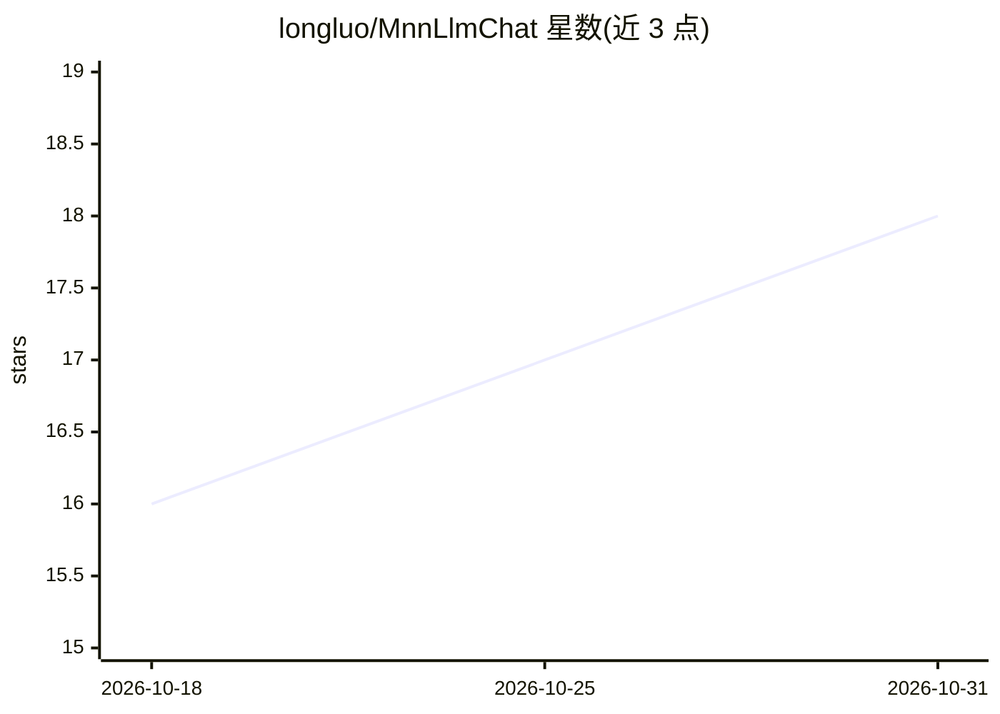

# longluo/MnnLlmChat

⭐ 18 · C++ · MIT · 推送 2026-07-13 · [GitHub](https://github.com/longluo/MnnLlmChat) · 组织维护 · 中文 README

**Android 端离线多模态 LLM 聊天应用（基于 MNN）**

基于阿里巴巴 MNN-LLM 推理引擎的 Android 应用，支持文本对话、图像理解、语音识别与 TTS、文生图（扩散模型）等多模态任务，全部推理在设备本地完成，不上传数据。应用内可浏览、下载并切换 Qwen、Gemma、Llama、DeepSeek 等多家模型，支持通过 adb 推送本地模型、精度与线程数设置、思考模式切换，并提供 API 服务与 Anthropic 协议兼容。仅在一加 13 与小米 14 Ultra 上经过测试，低端设备可能出现推理缓慢或无法运行。可通过 Releases/Google Play 下载，或使用 Android Studio+NDK 自行编译。

## 筛选速览

| 维度 | 判定 | 备注 |
|---|---|---|
| AI 角色 | `ai-native` | 本体是模型或模型工具 |
| 许可风险 | `permissive` | MIT |
| 部署形态 | `None` |  |
| 模型依赖 | — | README 未给出锁定关系 |
| 硬件要求 | — | 无带数字的原话,不猜 |
| 安装摩擦 | `medium` | 含编译或系统依赖之一 |
| 成熟度 | — | 结构信号不足 |

## 能力要点

- 多模态：文生文、图生文、语音转文本、文生图（扩散模型）
- 完全本地推理，数据不上传外部服务器
- 应用内下载/切换多家模型（Qwen、Gemma、DeepSeek、Llama 等）
- 实时语音通话（ASR+TTS）与视觉输入

## 适用场景

- 在 Android 手机上离线运行大语言模型对话
- 手机端使用多模态模型识图、语音交互与生成图片
- 不联网环境下保护隐私地使用 AI 助手

## 场景标签

`AI 助手` `语音 Agent` `图像生成` `多模态` · 领域:对话与助手

## 证据(README 行号)

> L20: + **Multimodal Support:** Enables functionality across diverse tasks, including text-to-text, image-to-text, audio-
> L26: + **Privacy First:** Runs entirely on-device, ensuring complete data privacy with no information uploaded to extern
> L30: + After installing the application, you can browse all supported models, download them, and interact with them dire

## 星数曲线

2026-10-18 16 → 2026-10-31 18（+2）

---
*卡片 v1 · prompt 1.4 · 生成 2026-10-29 · 置信度 high · 依据 README sha `2ccdf752a313` · [字段定义](../../DATASET.md)*
